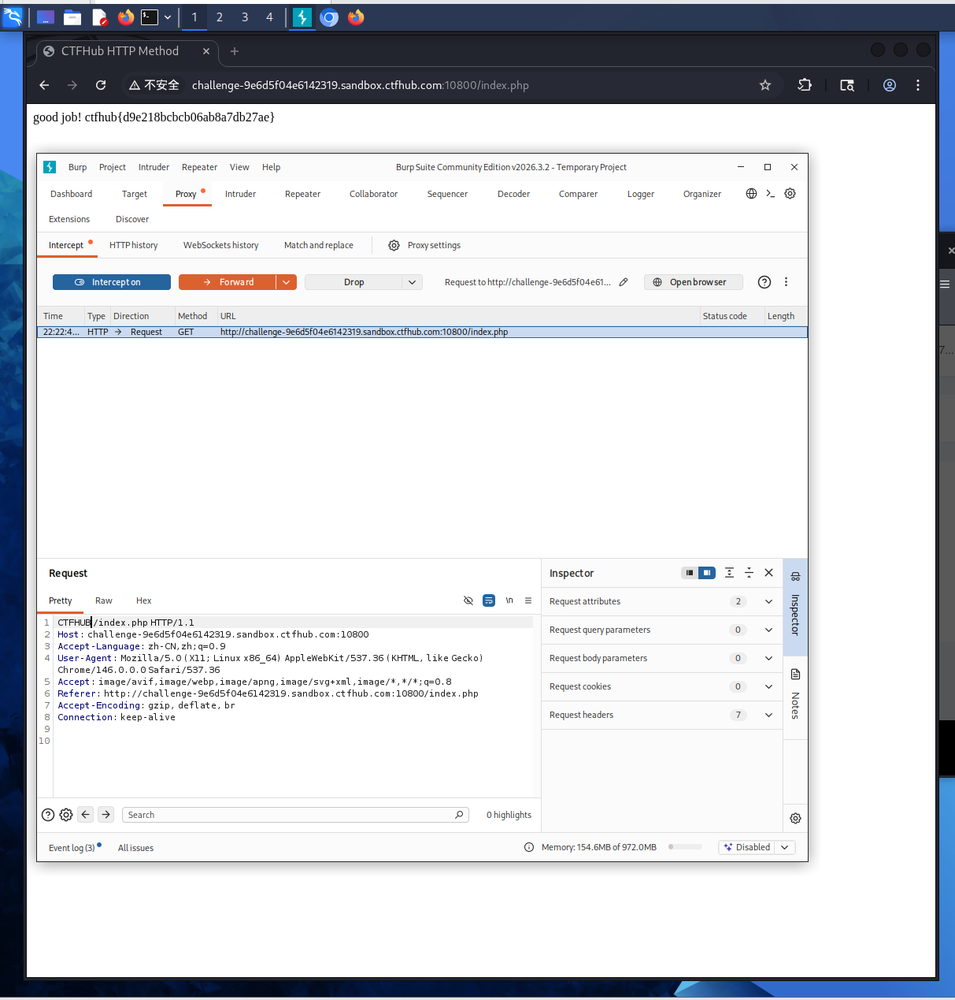

# WP：请求方式（HTTP 协议）

## 一、题目信息

- **题目名称**：请求方式
- **CTFHub 路径**：Web 前置技能 → HTTP 协议 → 请求方式
- **考察点**：HTTP 方法不止 GET/POST，服务端按请求行中的方法名分发；用"正确"的方法访问才会返回 flag。
- **靶场地址**：http://challenge-9e6d5f04e6142319.sandbox.ctfhub.com:10800/index.php

## 二、解题过程

- **我看到了什么**：普通用 GET 访问 `/index.php` 拿不到 flag，题目提示要使用特定的 HTTP 方法。
- **我做了什么**：先用 `curl -i -X OPTIONS` 探测服务器声明支持的方法；随后按提示用自定义方法 `CTFHUB` 发送请求：`curl -X CTFHUB http://challenge-9e6d5f04e6142319.sandbox.ctfhub.com:10800/index.php`。
- **结果是什么**：改用 `CTFHUB` 方法后，响应体返回 "good job!" 以及 `ctfhub{...}` 形式的 flag，提交后平台提示正确。

**思路与可参考的命令（在 Kali 终端 / curl 中完成）**：

```bash
# 探测支持/声明的方法
curl -i -X OPTIONS http://challenge-9e6d5f04e6142319.sandbox.ctfhub.com:10800/index.php

# 用题目提示的方法发起请求
curl -X CTFHUB http://challenge-9e6d5f04e6142319.sandbox.ctfhub.com:10800/index.php
```

## 三、关键请求 / 响应

```
CTFHUB /index.php HTTP/1.1
Host: challenge-9e6d5f04e6142319.sandbox.ctfhub.com:10800
User-Agent: curl/8.x

HTTP/1.1 200 OK
Content-Type: text/html

good job! ctfhub{d9e218bcbcb06ab8a7db27ae}
```

flag 提交：ctfhub{d9e218bcbcb06ab8a7db27ae}

## 四、原理与复盘

HTTP 请求行的第一项是方法（Method）。除了常见的 GET/POST，协议还定义了 PUT、DELETE、OPTIONS 等，甚至允许服务端自定义方法。该题目让服务端只对特定方法返回 flag，用来体会"方法"这一字段的作用。对应 HTTP 报文位置是 **请求行（方法）**。注意：方法本身不是安全边界，真正的安全要靠服务端的权限校验。

## 五、解题截图


