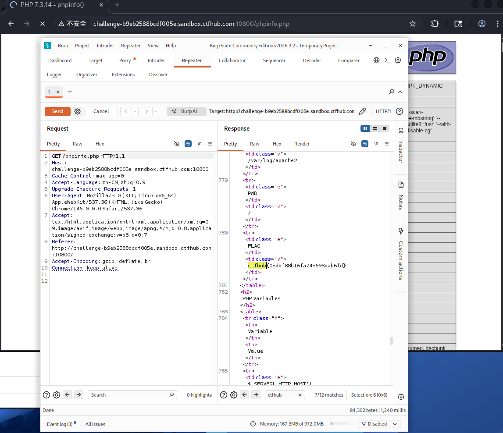

# WP：PHPINFO（信息泄露）

## 一、题目信息

- **题目名称**：PHPINFO
- **CTFHub 路径**：信息泄露 → PHPINFO
- **考察点**：通过 `phpinfo()` 页面获取大量服务器配置与环境信息，并在其中找到 flag。
- **靶场地址**：http://challenge-b9eb2588bcdf005e.sandbox.ctfhub.com:10800/phpinfo.php

## 二、解题过程

- **我看到了什么**：开启题目后访问靶场，提示去查看 phpinfo；直接打开 `/phpinfo.php` 是一个标准的 PHP 信息页。
- **我做了什么**：在 Kali 的 Firefox 里打开 `phpinfo.php`，按 `Ctrl + F` 搜索 `flag` / `CTFHUB`；也可以 `curl` 拉取后用 `grep` 过滤。
- **结果是什么**：在 "PHP Variables" 表格上方的环境变量表中，找到名为 **FLAG**（紧随 PWD 之后）的变量，其值就是 `ctfhub{...}`，提交后平台提示正确。

**思路与可参考的命令（在 Kali 终端 / curl 或浏览器中完成）**：

```bash
# 拉取 phpinfo 页面并直接搜索 flag
curl -s http://challenge-b9eb2588bcdf005e.sandbox.ctfhub.com:10800/phpinfo.php | grep -i -A1 -B1 "flag\|ctfhub"
```

## 三、关键请求 / 响应

```
GET /phpinfo.php HTTP/1.1
Host: challenge-b9eb2588bcdf005e.sandbox.ctfhub.com:10800
User-Agent: curl/8.x

HTTP/1.1 200 OK
Content-Type: text/html

...（phpinfo 输出）...
FLAG => ctfhub{05dbf88b16fa745693dab6fd}
```

flag 提交：ctfhub{05dbf88b16fa745693dab6fd}

## 四、原理与复盘

`phpinfo()` 会输出大量服务器信息：真实路径、环境变量、PHP 版本与加载的模块、Cookie 设置等，属于典型的信息泄露。CTFHub 把 flag 藏在这份输出里，需要耐心搜索。对应 HTTP 报文位置是 **响应体**。防御上应避免在生产环境暴露 phpinfo，并对敏感配置做最小化。

## 五、解题截图


