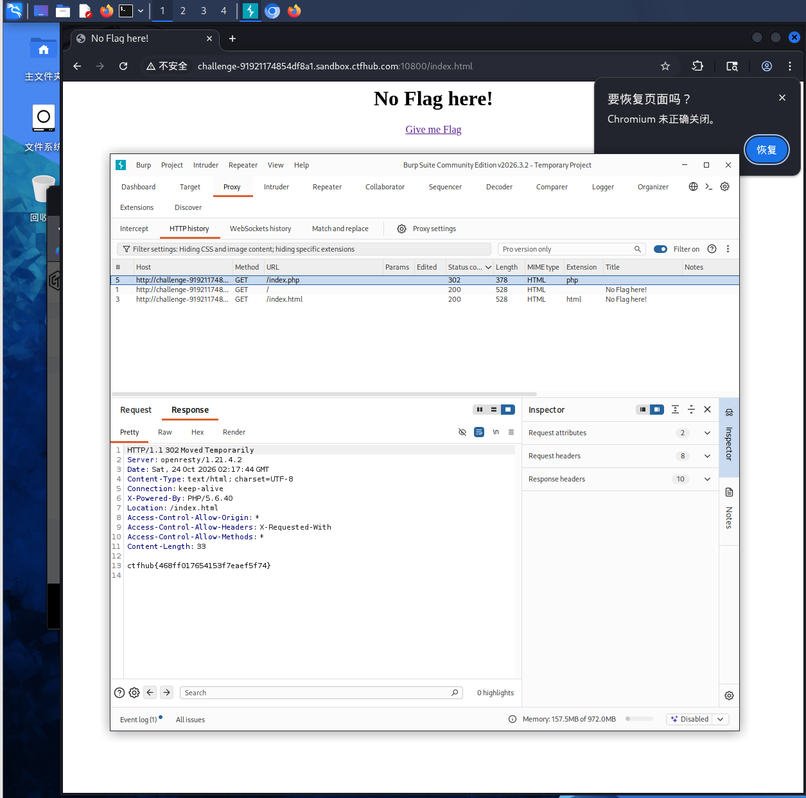

# WP：302 跳转（HTTP 协议）

## 一、题目信息

- **题目名称**：302 跳转
- **CTFHub 路径**：Web 前置技能 → HTTP 协议 → 302 跳转
- **考察点**：服务端用 302 临时重定向，flag 藏在 302 这一刻的响应里（响应体、Location 头或某个响应头），浏览器会自动跟随跳转从而"错过"它。
- **靶场地址**：http://challenge-91921714854df8a1.sandbox.ctfhub.com:10800/

## 二、解题过程

- **我看到了什么**：在浏览器里访问靶场根路径，页面立刻被重定向到 `/index.html`，跳转后的页面看不到任何 flag。
- **我做了什么**：改用 `curl -i`（不加 `-L`）查看完整的 302 响应，不让它自动跟随跳转；也可以在 DevTools Network 里勾选 "Preserve log" 观察那条 302 记录。
- **结果是什么**：在 302 响应的**响应体**里找到了 `ctfhub{...}` 形式的 flag（响应头给出 `Location: /index.html`），提交后平台提示正确。

**思路与可参考的命令（在 Kali 终端 / curl 或浏览器 DevTools 中完成）**：

```bash
# -i 查看完整响应头+体；关键：不要加 -L，否则会自动跟随跳转看不到 302 本身
curl -i http://challenge-91921714854df8a1.sandbox.ctfhub.com:10800/
```

## 三、关键请求 / 响应

```
GET / HTTP/1.1
Host: challenge-91921714854df8a1.sandbox.ctfhub.com:10800
User-Agent: curl/8.x

HTTP/1.1 302 Moved Temporarily
Location: /index.html
Content-Type: text/html

ctfhub{469ff017654153f7eaef5f74}
```

flag 提交：ctfhub{469ff017654153f7eaef5f74}

## 四、原理与复盘

302 是临时重定向状态码，浏览器收到后会自动请求 `Location` 指向的新地址，于是重定向响应里的 flag 一闪而过。对应 HTTP 报文位置是 **状态行（302）/ 响应头（Location）**。用 `curl -i`（不跟随）或 DevTools 的 Preserve log 才能"定格"看这一刻的内容。注意区分 301（永久）与 302（临时）。

## 五、解题截图


