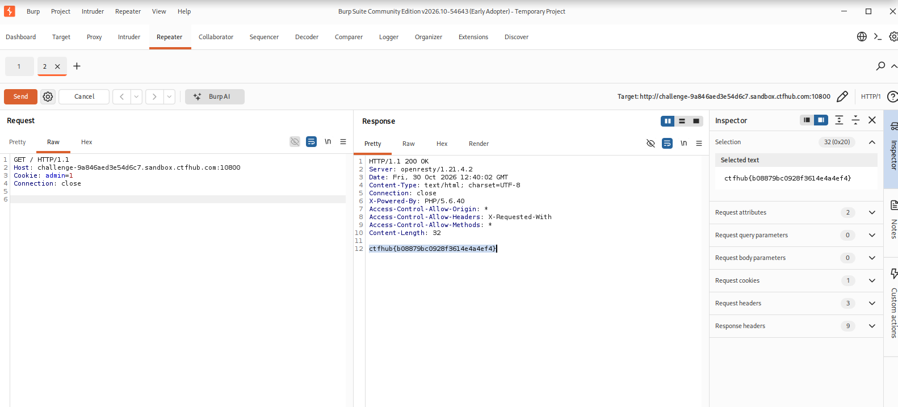

# WP：Cookie

> **CTFHub 路径**：技能树 → Web → Web 前置技能 → HTTP 协议 → Cookie
> **任务**：按题目提示修改 Cookie，拿到 flag。
> **提示**：在 DevTools 的 Application/Storage → Cookies 中查看 Cookie，或在 Burp 的请求头中查看。修改后重放请求，观察页面变化。
> **截图要求**：能看到修改后的 Cookie 请求头，以及服务器返回的 flag 或成功页面。

---

## 题目信息

| 项目 | 内容 |
| --- | --- |
| 环境地址 | `http://challenge-9a846aed3e54d6c7.sandbox.ctfhub.com:10800/` |
| Flag | `ctfhub{08879bc0928f361e4a4e4ef4}` |

## 解题过程

开启题目后用浏览器访问靶场，页面只回显了一句 `hello guest`，没有任何输入框和链接，说明服务器是**按访问者身份**决定回显内容的，而判断身份的依据只能来自浏览器自动带上的 Cookie。

在 Burp 的 `Proxy → HTTP history` 里找到这条 `GET /` 请求，请求头里有一行 `Cookie: admin=0`，含义很直白：服务器用一个名为 `admin` 的 Cookie 标记「你是不是管理员」，当前的 `0` 代表普通访客，所以页面才叫我 guest。于是把这条请求发送到 **Repeater**（右键 → `Send to Repeater`），在左侧 Request 区把 `Cookie: admin=0` 改成 `Cookie: admin=1`，点击 **Send** 重放。

改完后响应状态行仍然是 `HTTP/1.1 200 OK`，但响应体从 `hello guest` 变成了一串 flag，说明服务器只信 Cookie 里的值，把 `admin=1` 当成了管理员的会话。拿到 flag 后在题目页面提交，确认正确。

## 关键请求/响应

```http
GET / HTTP/1.1
Host: challenge-9a846aed3e54d6c7.sandbox.ctfhub.com:10800
Cookie: admin=1
Connection: close

HTTP/1.1 200 OK
Server: openresty/1.21.4.2
Date: Fri, 30 Oct 2026 12:40:02 GMT
Content-Type: text/html; charset=UTF-8
Connection: close
X-Powered-By: PHP/5.6.40
Access-Control-Allow-Origin: *
Access-Control-Allow-Headers: X-Requested-With
Access-Control-Allow-Methods: *
Content-Length: 32

ctfhub{08879bc0928f361e4a4e4ef4}
```

改包前后唯一的差别就是 Cookie 的值：`admin=0`（回显 `hello guest`）→ `admin=1`（回显 flag）。

## 原理与复盘

Cookie 是**请求头**的一部分，属于客户端保存、每次请求自动回传的一小段键值数据：服务器在响应里用 `Set-Cookie` 把它种下来，浏览器之后访问同一域名就自动带上。本题服务器把「是不是管理员」这个判断直接交给了 Cookie 的值，而 Cookie 完全存放在客户端、可以随意修改，于是只要把 `admin` 改成 `1` 就冒充成功。

正确的做法应该是 Cookie 里只放一个不可猜测的会话 ID（Session ID），权限和身份存在服务端，由服务端按 ID 查表判断——这就是「Session 存服务端、Cookie 存客户端」的区别。这道题和 302 跳转正好组成对照：一个利用**请求头**可被篡改，一个利用**状态行/响应头**被浏览器自动跟随，两者都说明 HTTP 报文的每一部分都可能成为攻击面。

---

## 截图



> 可以在这份 WP 中另加过程截图；检查时只看指定图片，额外图片不检查。
