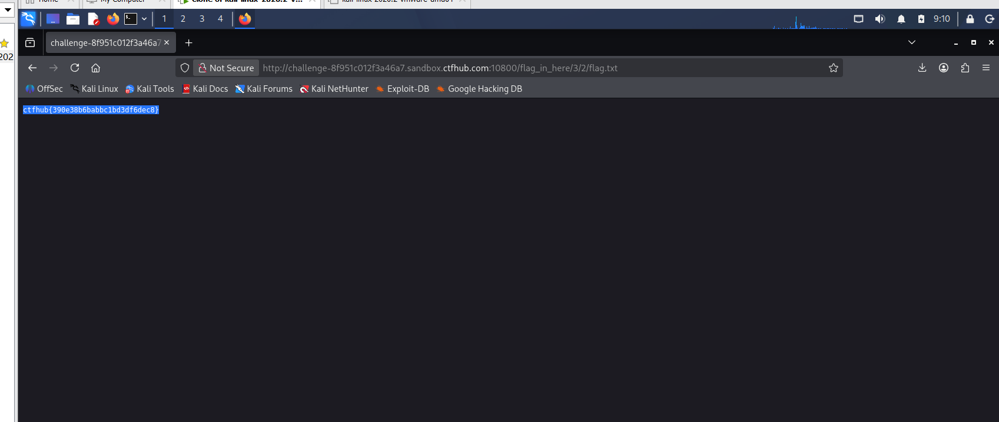

# WP：目录遍历

> **CTFHub 路径**：技能树 → Web → 信息泄露 → 目录遍历
> **任务**：按题目页面提示找到 flag。
> **提示**：注意页面给出的路径和 URL；目录列表本身就是一种信息泄露。只在题目环境内点击和访问，不要使用扫描器扫描其他地址。
> **截图要求**：能看到题目环境地址（或题目名称）、你访问的目录/路径，以及最终的 flag。

---

## 题目信息

| 项目 | 内容 |
| --- | --- |
| 环境地址 | `http://challenge-8f951c012f3a46a7.sandbox.ctfhub.com:10800/flag_in_here/3/2/flag.txt` |
| Flag | `ctfhub{390e38b6babbc1bd3df6dec8}` |

## 解题过程

打开靶场首页，页面只有一个「点击开始寻找flag」的按钮，链接指向 `flag_in_here/`，没有任何提示说 flag 具体在哪一层。

点进去以后，看到的不是网页，而是 Apache 的**目录列表**：标题是 `Index of /flag_in_here`，下面用表格列出了 `1/`、`2/`、`3/`、`4/` 四个子目录。这说明服务器的 `autoindex` 开着，把目录下的内容直接列给了访问者——本来应该由开发者自己知道的结构，现在谁都能看到。

接下来就是顺着点。每个目录里又是 `1/`~`4/` 四个子目录，一层套一层；到第三层 `flag_in_here/3/2/` 时，列表里出现的不再是目录，而是一个文件 `flag.txt`，大小 33 字节。

点开 `flag.txt`，浏览器直接显示 `ctfhub{390e38b6babbc1bd3df6dec8}`，说明 flag 就是一个纯文本文件，被放在层层嵌套的目录里，只靠「不知道路径」来保护——一旦目录能被列出，这层保护就不存在了。

## 关键请求/响应

访问 `flag_in_here/` 时返回的目录列表（节选）：

```http
GET /flag_in_here/ HTTP/1.1
Host: challenge-8f951c012f3a46a7.sandbox.ctfhub.com:10800

HTTP/1.1 200 OK
Server: openresty/1.21.4.2
Content-Type: text/html; charset=UTF-8
X-Powered-By: PHP/7.3.14

<title>Index of /flag_in_here</title>
<h1>Index of /flag_in_here</h1>
<tr><td><a href="1/">1/</a></td></tr>
<tr><td><a href="2/">2/</a></td></tr>
<tr><td><a href="3/">3/</a></td></tr>
<tr><td><a href="4/">4/</a></td></tr>
<address>Apache/2.4.38 (Debian) Server at challenge-8f951c012f3a46a7.sandbox.ctfhub.com Port 10800</address>
```

最终拿到 flag 的请求：

```http
GET /flag_in_here/3/2/flag.txt HTTP/1.1
Host: challenge-8f951c012f3a46a7.sandbox.ctfhub.com:10800

HTTP/1.1 200 OK
Server: openresty/1.21.4.2
Date: Fri, 30 Oct 2026 13:07:31 GMT
Content-Type: text/plain; charset=utf-8
Content-Length: 33
Last-Modified: Fri, 30 Oct 2026 13:05:12 GMT
ETag: "21-65f0e724bf51b"
Accept-Ranges: bytes

ctfhub{390e38b6babbc1bd3df6dec8}
```

本题不需要修改请求，flag 是顺着目录列表一层层点出来的：`/flag_in_here/` → `3/` → `2/` → `flag.txt`。

## 原理与复盘

这道题对应的是 HTTP 报文里的**请求行中的 URL 路径**部分：`GET /flag_in_here/3/2/flag.txt` 里的每一段目录，都是客户端可以直接指定的资源位置，服务器只负责按路径去找文件。所谓「目录遍历」，本质是服务器没有把目录访问限制住（Apache 的 `Options +Indexes`），于是访问一个目录时返回的不是 403，而是一份完整的文件清单。

信息泄露的危害在于降低攻击成本：正常要猜的路径，现在被服务器主动列出来了，攻击者可以直接看到备份文件、配置文件、源码目录甚至数据库导出文件。防护上应当关闭目录自动索引（`Options -Indexes`），敏感文件放在 Web 根目录之外，并且不要用「藏在深层目录里」当安全措施。

---

## 截图



> 可以在这份 WP 中另加过程截图；检查时只看指定图片，额外图片不检查。
