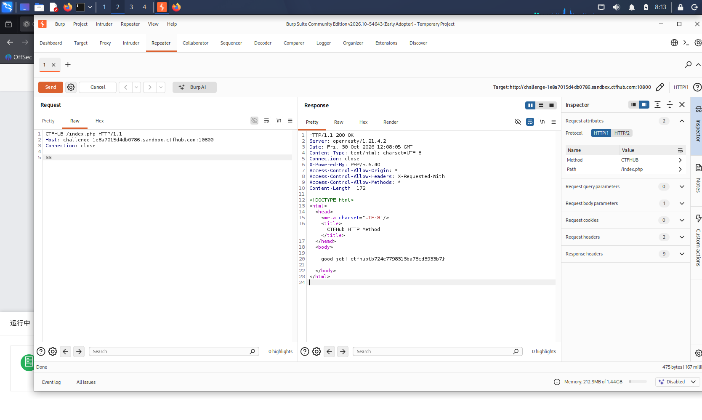

# WP：请求方式

> **CTFHub 路径**：技能树 → Web → Web 前置技能 → HTTP 协议 → 请求方式
> **任务**：按题目要求使用指定的 HTTP 方法访问目标，拿到 flag。
> **提示**：浏览器地址栏默认发送 GET 请求。用 Burp Repeater 修改请求行中的方法，或者用 `curl -X` 复现。
> **截图要求**：优先使用 Burp Repeater，截图中要能看到修改后的请求行（方法 + 路径）和响应中的 flag；如果 Burp 无法启动，可以用 `curl -X` 的方法修改截图代替，并在 WP 中说明原因。只有浏览器普通 GET 访问不算完成。

---

## 题目信息

| 项目 | 内容 |
| --- | --- |
| 环境地址 | `http://challenge-1e8a7015d4db0786.sandbox.ctfhub.com:10800/index.php` |
| Flag | `ctfhub{b724a779831b3a73cd993b7}` |

## 解题过程

访问靶场首页，页面直接输出两行提示：`HTTP Method is GET` 和 `Use CTF**B Method, I will give you flag.`。第一行说明当前请求是以 GET 方法发出的；第二行把方法名挖掉了两个字母，`CTF**B` 补全后就是 `CTFHUB`（`CTF` 加上 `HUB`，中间的 `HU` 被星号替换），所以目标方法名应当为 `CTFHUB`。

页面下方还有一行提示：如果收到 `HTTP Method Not Allowed`，说明没有请求到正确的入口文件，应当访问 `index.php`。因此我把请求目标固定为 `/index.php`，而不是根路径 `/`。

打开 Burp Suite，在 Repeater 标签页新建一个请求，把请求行第一行的方法从 `GET` 手动改成 `CTFHUB`，路径写 `/index.php`，并在 `Host` 头里填上靶场域名和端口 `10800`。需要注意不能使用右键菜单里的 "Change request method"，因为那个功能只在标准方法（GET/POST 等）之间切换，无法构造自定义方法，只能手工修改请求行。

点击 Send 后，服务器返回 `HTTP/1.1 200 OK`，响应体是一个极简 HTML 页面，正文为 `good job! ctfhub{b724a779831b3a73cd993b7}`，其中 `ctfhub{...}` 即为本题 flag。这说明服务器的方法白名单里包含了自定义的 `CTFHUB`，而不是只接受标准方法。

## 关键请求/响应

```http
CTFHUB /index.php HTTP/1.1
Host: challenge-1e8a7015d4db0786.sandbox.ctfhub.com:10800
Connection: close

HTTP/1.1 200 OK
Server: openresty/1.21.4.2
Date: Fri, 30 Oct 2026 12:08:05 GMT
Content-Type: text/html; charset=UTF-8
Connection: close
X-Powered-By: PHP/5.6.40
Access-Control-Allow-Origin: *
Access-Control-Allow-Headers: X-Requested-With
Access-Control-Allow-Methods: *
Content-Length: 172

<html><head><meta charset="UTF-8"/><title>CTFHub HTTP Method</title></head><body>
good job! ctfhub{b724a779831b3a73cd993b7}
</body></html>
```

## 原理与复盘

请求行由**方法、请求目标（路径）、HTTP 版本**三部分组成，格式为 `方法 + 空格 + 请求目标 + 空格 + HTTP版本`，例如 `CTFHUB /index.php HTTP/1.1`；方法位于请求行的**第一个 token**，是服务器解析该行的起点。

服务端的路由和权限判断都建立在方法之上，很多框架会按方法分发到不同的处理函数，或者维护一份允许的方法白名单。本题的白名单里包含了一个非标准的自定义方法 `CTFHUB`，因此只要改掉请求行的第一个词就能通过检查。这也说明 HTTP 方法本质上是客户端可自由填写的字符串，服务端**不能假定客户端只会发送标准方法**，必须显式校验并拒绝未预期的方法。

---

## 截图



> 可以在这份 WP 中另加过程截图；检查时只看指定图片，额外图片不检查。
