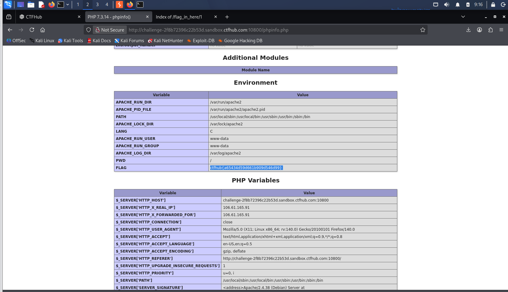

# WP：PHPINFO

> **CTFHub 路径**：技能树 → Web → 信息泄露 → PHPINFO
> **任务**：在 phpinfo 页面中找到 flag，并观察它泄露了哪些信息。
> **提示**：phpinfo 会输出大量 PHP 和服务器配置。用浏览器的查找功能搜索关键字，同时留意页面暴露的路径、版本、环境变量等信息。
> **截图要求**：能看到 phpinfo 页面、你搜索/定位到的 flag，以及至少一处敏感信息。

---

## 题目信息

| 项目 | 内容 |
| --- | --- |
| 环境地址 | `http://challenge-2f8b72396c22b53d.sandbox.ctfhub.com:10800/phpinfo.php` |
| Flag | `ctfhub{a65434d59d661b909d546d99}` |

## 解题过程

访问靶场根路径，页面只有一个按钮「点击查看phpinfo」，链接指向 `phpinfo.php`——也就是说服务器把一个 `phpinfo()` 页面直接放在了公网上。

点进去以后是一整页密密麻麻的表格，几百行配置项。这种方式人眼一行行看是不可能的，所以我先用浏览器自带的查找功能 `Ctrl + F` 搜关键字。先搜 `flag`，页面立刻跳到 **Environment** 这张表的最后一行，变量名是 `FLAG`，值就是 `ctfhub{a65434d59d661b909d546d99}`——flag 被服务端作为**环境变量**注入到了 Apache 进程里，而 phpinfo 会把所有环境变量原样打印出来。

同一张表里还能看到一堆本来不该给外人看的东西：`APACHE_RUN_USER = www-data`、`APACHE_LOG_DIR = /var/log/apache2`、完整的 `PATH`。再往上翻，`PHP Version 7.3.14`、`System` 里的内核版本 `Linux ... 6.12.48+deb13-amd64` 也都暴露了；在 `PHP Variables` 段里还有 `$_SERVER['DOCUMENT_ROOT'] = /var/www/html/`、`$_SERVER['SCRIPT_FILENAME'] = /var/www/html/phpinfo.php` 和 `Loaded Configuration File = (none)`。拿到 flag 后在题目页面提交，确认正确。

## 关键请求/响应

访问的页面：

```http
GET /phpinfo.php HTTP/1.1
Host: challenge-2f8b72396c22b53d.sandbox.ctfhub.com:10800
```

响应体是完整的 phpinfo 输出（约 80 KB HTML），其中 `Environment` 段的末尾就是 flag：

```html
<h2>Environment</h2>
<table>
<tr class="h"><th>Variable</th><th>Value</th></tr>
<tr><td class="e">APACHE_RUN_USER </td><td class="v">www-data </td></tr>
<tr><td class="e">APACHE_RUN_GROUP </td><td class="v">www-data </td></tr>
<tr><td class="e">APACHE_LOG_DIR </td><td class="v">/var/log/apache2 </td></tr>
<tr><td class="e">PWD </td><td class="v">/ </td></tr>
<tr><td class="e">FLAG </td><td class="v">ctfhub{a65434d59d661b909d546d99} </td></tr>
</table>
```

同一个值在 `PHP Variables` 段里也会再出现一次：

```html
<tr><td class="e">$_ENV['FLAG']</td><td class="v">ctfhub{a65434d59d661b909d546d99}</td></tr>
```

顺带暴露的其他敏感字段：

```text
PHP Version             7.3.14
System                  Linux challenge-2f8b72396c22b53d-... 6.12.48+deb13-amd64
SERVER_SOFTWARE         Apache/2.4.38 (Debian)
DOCUMENT_ROOT           /var/www/html/
SCRIPT_FILENAME         /var/www/html/phpinfo.php
SERVER_ADMIN            webmaster@localhost
Loaded Configuration File   (none)
```

## 原理与复盘

phpinfo 是 PHP 的调试函数，它把当前进程能拿到的信息全部打印出来：PHP 编译参数与版本、所有 `php.ini` 配置项、Apache/Nginx 的环境变量、`$_SERVER` 与 `$_ENV` 的内容、加载的扩展、甚至内网 IP 和绝对路径。本题的 flag 就是以环境变量的形式存在于容器里，本来轮不到访问者看见，却因为页面被直接暴露而一并打印了出来。

这类页面对攻击者的价值在于「省掉侦察」：知道 PHP 版本就能挑对应的已知漏洞，知道 `DOCUMENT_ROOT` 和绝对路径就能构造文件包含、文件上传的 payload，知道运行用户是 `www-data` 就能判断提权方向，知道内核版本就能找本地提权 exp。防护上很简单——生产环境不要部署 `phpinfo.php`，调试完立刻删除，并且 `php.ini` 里关掉 `expose_php`，避免响应头里再泄露版本号。

---

## 截图



> 可以在这份 WP 中另加过程截图；检查时只看指定图片，额外图片不检查。
