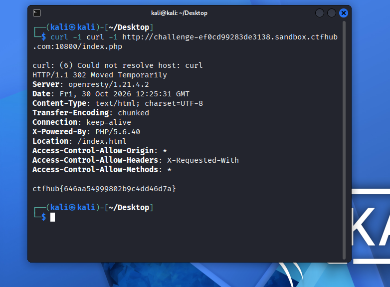

# WP：302 跳转

> **CTFHub 路径**：技能树 → Web → Web 前置技能 → HTTP 协议 → 302 跳转
> **任务**：观察 302 重定向，按题目提示找到 flag。
> **提示**：浏览器通常会自动跟随 302，所以你可能只看到最终页面。打开 DevTools 的 Network 面板（勾选 Preserve log）或 Burp，查看原始响应中的 `302` 状态码和 `Location` 响应头。
> **截图要求**：能看到 302 状态码和/或 `Location` 响应头，以及最终的 flag。只截最终页面、没有 302 证据的截图不合格。

---

## 题目信息

| 项目 | 内容 |
| --- | --- |
| 环境地址 | `http://challenge-ef0cd99283de3138.sandbox.ctfhub.com:10800/index.php` |
| Flag | `ctfhub{646aa54999802b9c4dd46d7a}` |

## 解题过程

第一次用浏览器访问靶场，页面只有一行大字 `No Flag here!`，下面跟着一个 `Give me Flag` 的链接，直接打开首页是拿不到 flag 的。点击 `Give me Flag` 后，地址栏很快就变成了 `index.html`，页面内容还是那句 `No Flag here!`，看起来像什么也没发生。

这里的关键是：浏览器**默认会自动跟随 302 跳转**，所以那一跳在界面上被吞掉了，用户只能看到最终落地的页面。要看到原始的 302 响应，必须绕开浏览器的自动跟随。

于是改用 curl，并且加上 `-i` 参数让响应头一起输出，同时**故意不加 `-L`**（`-L` 就是让 curl 跟随跳转，加了就和浏览器一样看不到 302）。请求的路径是页面里那个链接指向的 `index.php`，而不是根路径。

命令执行后，输出里第一行就是 `HTTP/1.1 302 Moved Temporarily`，响应头里有 `Location: /index.html`，而响应体的最后一行直接就是 `ctfhub{646aa54999802b9c4dd46d7a}`。也就是说 flag 藏在 **302 响应自身**里，不在跳转后的页面上；如果跟随了跳转，这个响应体就被丢掉了。

## 关键请求/响应

```http
GET /index.php HTTP/1.1

HTTP/1.1 302 Moved Temporarily
Server: openresty/1.21.4.2
Date: Fri, 30 Oct 2026 12:25:31 GMT
Content-Type: text/html; charset=UTF-8
Transfer-Encoding: chunked
Connection: keep-alive
X-Powered-By: PHP/5.6.40
Location: /index.html
Access-Control-Allow-Origin: *
Access-Control-Allow-Headers: X-Requested-With
Access-Control-Allow-Methods: *

ctfhub{646aa54999802b9c4dd46d7a}
```

## 原理与复盘

200 表示服务器把内容直接返回给客户端，浏览器就地渲染；302 表示「资源临时搬到别处了」，它本身**不带页面内容**，只靠 `Location` 响应头告诉客户端下一个地址，客户端需要再发一次请求才能拿到真正的资源。

两者的表现差异就在客户端行为上：浏览器收到 302 会自动再请求 `Location` 指向的地址，用户几乎察觉不到；而 curl 默认不跟随，加 `-L` 才跟随。本题正是利用这一点——flag 放在 302 响应的**响应体**里，一旦跟随跳转，这个响应体就被丢弃了，所以只有「不跟随」才能拿到它。

---

## 截图



> 可以在这份 WP 中另加过程截图；检查时只看指定图片，额外图片不检查。
