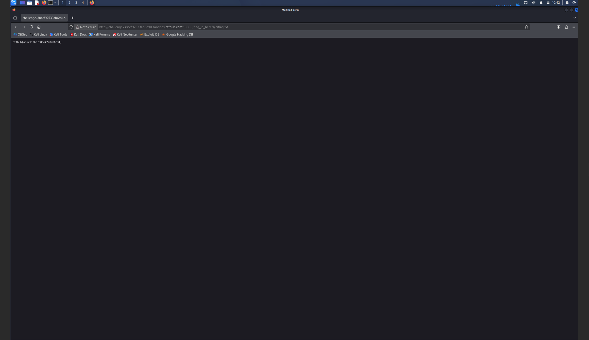

# WP：目录遍历

> **CTFHub 路径**：技能树 → Web → 信息泄露 → 目录遍历
> **任务**：按题目页面提示找到 flag。
> **提示**：注意页面给出的路径和 URL；目录列表本身就是一种信息泄露。只在题目环境内点击和访问，不要使用扫描器扫描其他地址。
> **截图要求**：能看到题目环境地址（或题目名称）、你访问的目录/路径，以及最终的 flag。

---

## 题目信息

| 项目 | 内容 |
| --- | --- |
| 环境地址 | http://challenge-38ccf92533ab6c90.sandbox.ctfhub.com:10800/flag_in_here/1/2/flag.txt |
| Flag | ctfhub{ad6c913bd700de42e8dd6031} |

## 解题过程

开启题目后访问靶场根目录，返回的不是正常网页，而是把站点目录里的东西列了出来，能看到 `flag_in_here` 这个目录，点进去还有用数字命名的子目录。我按题目提示一层层往下点，每进一级页面都还会继续列出下一级的子目录，说明服务器对目录浏览是完全放开的，没把 `flag_in_here` 这种路径当成私密路径。点到 `/flag_in_here/1/2/` 这一级时，目录里出现了一个 `flag.txt`，点开它浏览器直接把纯文本内容显示出来，就是 flag。整个过程我没有改过任何一个请求参数，漏洞就是服务器把“目录里有什么文件”直接告诉了我。

## 关键请求/响应

```http
（逐层点击，浏览器发出的都是普通 GET）

GET /flag_in_here/ HTTP/1.1
Host: challenge-38ccf92533ab6c90.sandbox.ctfhub.com:10800

GET /flag_in_here/1/ HTTP/1.1
Host: challenge-38ccf92533ab6c90.sandbox.ctfhub.com:10800

GET /flag_in_here/1/2/ HTTP/1.1
Host: challenge-38ccf92533ab6c90.sandbox.ctfhub.com:10800

GET /flag_in_here/1/2/flag.txt HTTP/1.1
Host: challenge-38ccf92533ab6c90.sandbox.ctfhub.com:10800

HTTP/1.1 200 OK

ctfhub{ad6c913bd700de42e8dd6031}
```

## 原理与复盘

这道题的入口在 URL 路径上：服务器把请求的路径直接拼到站点根目录后面去读文件，而且没有关掉目录浏览，所以 `/flag_in_here/1/2/` 这样的路径返回的是文件清单而不是 403。目录列表本身就是信息泄露，它把目录下有什么文件直接列出来，等于替你做完了目录扫描，备份文件、源码、配置往往就是这样被翻出来的。所以这题的证据一半在请求行的路径字段，一半在响应体的目录列表里。

---

## 截图



> 可以在这份 WP 中另加过程截图；检查时只看指定图片，额外图片不检查。
