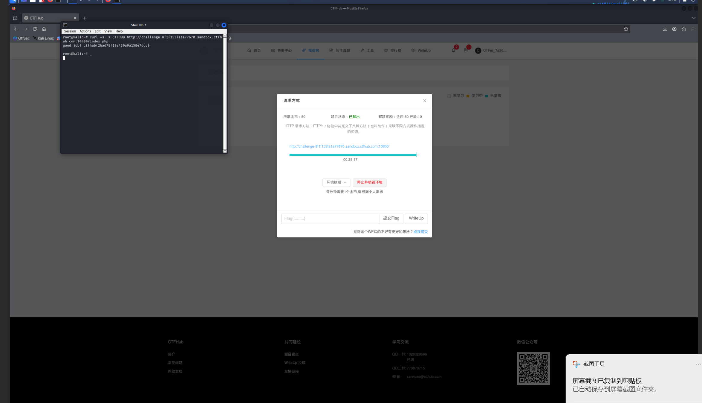

# WP：请求方式

> **CTFHub 路径**：技能树 → Web → Web 前置技能 → HTTP 协议 → 请求方式
> **任务**：按题目要求使用指定的 HTTP 方法访问目标，拿到 flag。
> **提示**：浏览器地址栏默认发送 GET 请求。用 Burp Repeater 修改请求行中的方法，或者用 `curl -X` 复现。
> **截图要求**：优先使用 Burp Repeater，截图中要能看到修改后的请求行（方法 + 路径）和响应中的 flag；如果 Burp 无法启动，可以用 `curl -X` 的方法修改截图代替，并在 WP 中说明原因。只有浏览器普通 GET 访问不算完成。

---

## 题目信息

| 项目 | 内容 |
| --- | --- |
| 环境地址 | http://challenge-8f1f153fa1a77670.sandbox.ctfhub.com:10800/index.php |
| Flag | ctfhub{2bad78f19a430a9a158e7dcc} |

## 解题过程

开启题目后，我先用浏览器直接访问靶场首页，页面上提示需要用题目指定的请求方法访问，普通的 GET 请求只能看到提示，拿不到 flag。浏览器地址栏只会发 GET 和 POST，没法自己指定方法，所以我改用 Kali 终端里的 curl，用 `-X` 参数把请求行里的方法改成 `CTFHUB`，重新请求同一个 `/index.php`。服务器这次正常返回了 HTML，页面标题是 `CTFHub HTTP Method`，正文里直接写着 `good job!` 和 flag。整个过程中我只改了请求行的第一个字段（方法名），Host 和路径都没有动，所以这题的考点就是“方法”这个位置。

## 关键请求/响应

```http
（1）浏览器默认发出的 GET，拿不到 flag

GET /index.php HTTP/1.1
Host: challenge-8f1f153fa1a77670.sandbox.ctfhub.com:10800

（2）改成题目要求的方法后，服务器返回 flag

$ curl -s -X CTFHUB http://challenge-8f1f153fa1a77670.sandbox.ctfhub.com:10800/index.php

CTFHUB /index.php HTTP/1.1
Host: challenge-8f1f153fa1a77670.sandbox.ctfhub.com:10800

<html>
<head>
    <meta charset="UTF-8"/>
    <title>CTFHub HTTP Method</title>
</head>
<body>

good job! ctfhub{2bad78f19a430a9a158e7dcc}

</body>
</html>
```

## 原理与复盘

请求行由三部分组成：方法、请求目标（路径）、HTTP 版本，`CTFHUB /index.php HTTP/1.1` 里方法就是这一行的第一个词。服务器经常用方法做判断——某个资源只对特定方法开放，而浏览器地址栏默认只会发 GET，所以这类题必须靠 `curl -X` 或 Burp 改请求行才能复现。方法名不限于 GET/POST，服务端完全可以自定义一个并单独校验，本题的 `CTFHUB` 就是自定义方法。

---

## 截图



> 可以在这份 WP 中另加过程截图；检查时只看指定图片，额外图片不检查。
