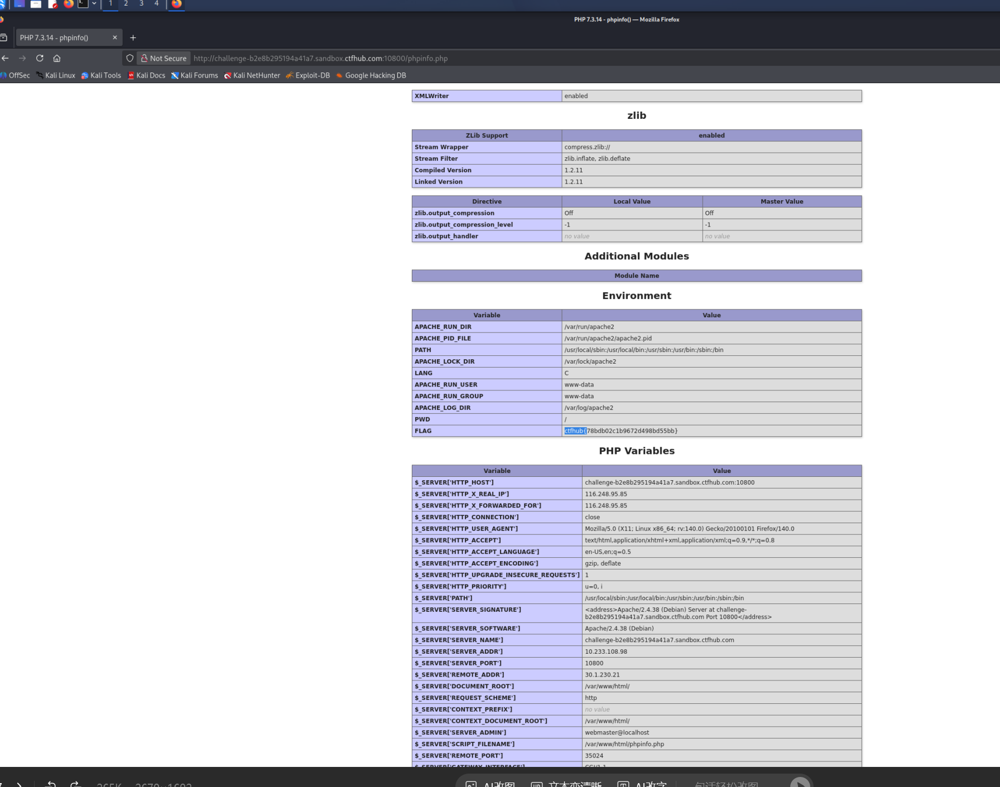

# WP：PHPINFO

> **CTFHub 路径**：技能树 → Web → 信息泄露 → PHPINFO
> **任务**：在 phpinfo 页面中找到 flag，并观察它泄露了哪些信息。
> **提示**：phpinfo 会输出大量 PHP 和服务器配置。用浏览器的查找功能搜索关键字，同时留意页面暴露的路径、版本、环境变量等信息。
> **截图要求**：能看到 phpinfo 页面、你搜索/定位到的 flag，以及至少一处敏感信息。

---

## 题目信息

| 项目 | 内容 |
| --- | --- |
| 环境地址 | http://challenge-b2e8b295194a41a7.sandbox.ctfhub.com:10800/phpinfo.php |
| Flag | ctfhub{78bdb02c1b9672d498bd55bb} |

## 解题过程

开启题目后访问靶场，站点根目录下直接就能打开 `phpinfo.php`，页面是标准的 PHP 配置输出，一屏一屏全是模块表格，肉眼翻根本找不到 flag。我按题目提示直接按 Ctrl+F 搜索关键字 `flag`，页面把光标定位到 Environment 表里的 `FLAG` 这一行，值就是 flag，省掉了翻页的功夫。顺手往上看，这张表还暴露了 Apache 的环境变量（`APACHE_RUN_USER` 是 `www-data`、`APACHE_LOG_DIR` 是 `/var/log/apache2`、`PWD` 是 `/`），往下翻的 PHP Variables 里还能看到 `SERVER_SOFTWARE` 是 Apache/2.4.38 (Debian)、`DOCUMENT_ROOT` 是 `/var/www/html`、服务器内网地址 `10.233.108.98`。也就是说这题既是“找到 flag”，也是“看看一个调试页能泄露多少底细”。

## 关键请求/响应

```http
GET /phpinfo.php HTTP/1.1
Host: challenge-b2e8b295194a41a7.sandbox.ctfhub.com:10800

HTTP/1.1 200 OK
Content-Type: text/html; charset=UTF-8

（Environment 表中的关键行）
APACHE_RUN_USER     www-data
APACHE_RUN_GROUP    www-data
APACHE_LOG_DIR      /var/log/apache2
PWD                 /
FLAG                ctfhub{78bdb02c1b9672d498bd55bb}

（PHP Variables 表）
$_SERVER['SERVER_SOFTWARE']   Apache/2.4.38 (Debian)
$_SERVER['DOCUMENT_ROOT']     /var/www/html
$_SERVER['SERVER_ADDR']       10.233.108.98
```

## 原理与复盘

phpinfo 本来是给开发调试用的，它会把 PHP 版本、编译参数、扩展模块、环境变量、绝对路径甚至配置里的敏感值原样输出，属于典型的“响应体信息泄露”。它本身不是一个能被直接利用的漏洞，但对攻击者来说等于一张地图：知道版本就能去找对应的 CVE，知道绝对路径就能猜文件读写和包含的位置，知道运行用户和内网地址就能判断拿下之后好不好继续。所以这种页面只应该留在内网并加访问控制，公网上挂着就是给攻击者送情报。

---

## 截图



> 可以在这份 WP 中另加过程截图；检查时只看指定图片，额外图片不检查。
