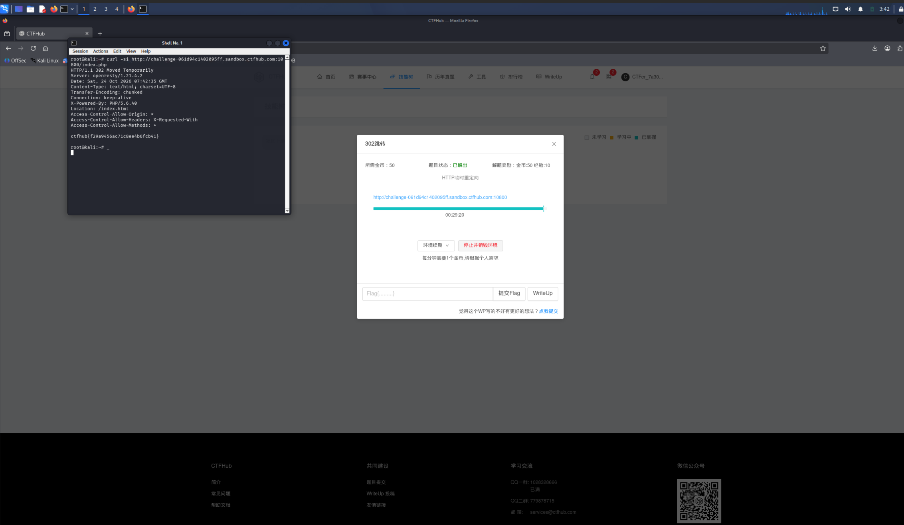

# WP：302 跳转

> **CTFHub 路径**：技能树 → Web → Web 前置技能 → HTTP 协议 → 302 跳转
> **任务**：观察 302 重定向，按题目提示找到 flag。
> **提示**：浏览器通常会自动跟随 302，所以你可能只看到最终页面。打开 DevTools 的 Network 面板（勾选 Preserve log）或 Burp，查看原始响应中的 `302` 状态码和 `Location` 响应头。
> **截图要求**：能看到 302 状态码和/或 `Location` 响应头，以及最终的 flag。只截最终页面、没有 302 证据的截图不合格。

---

## 题目信息

| 项目 | 内容 |
| --- | --- |
| 环境地址 | http://challenge-061d94c1402095ff.sandbox.ctfhub.com:10800/index.php |
| Flag | ctfhub{f29a9456ac71c8ee4b6fcb41} |

## 解题过程

开启题目后我用浏览器访问靶场首页，页面几乎瞬间变成了另一个地址的内容，看起来就是个普通欢迎页，地址栏里的路径也变了，说明中途发生了跳转。因为浏览器会自动跟随跳转，只看最终页面是看不到跳转本身的，于是我改用终端里的 curl 加 `-i` 参数，把状态行和响应头一起打印出来（再加 `-s` 把进度条静音，屏幕更干净）。这次响应里清楚写着 `HTTP/1.1 302 Moved Temporarily` 和 `Location: /index.html`，而且 302 这条响应自己的响应体里就直接给了 flag。

## 关键请求/响应

```http
$ curl -si http://challenge-061d94c1402095ff.sandbox.ctfhub.com:10800/index.php

GET /index.php HTTP/1.1
Host: challenge-061d94c1402095ff.sandbox.ctfhub.com:10800

HTTP/1.1 302 Moved Temporarily
Server: openresty/1.21.4.2
Date: Sat, 24 Oct 2026 07:42:35 GMT
Content-Type: text/html; charset=UTF-8
Transfer-Encoding: chunked
Connection: keep-alive
X-Powered-By: PHP/5.6.40
Location: /index.html
Access-Control-Allow-Origin: *
Access-Control-Allow-Headers: X-Requested-With
Access-Control-Allow-Methods: *

ctfhub{f29a9456ac71c8ee4b6fcb41}
```

## 原理与复盘

200 的意思是“你要的内容就在这次响应里”，浏览器直接把响应体渲染出来；302 的意思是“内容不在这里，去 `Location` 指的地址拿”，浏览器默认会自动跟过去，所以用户只看到最终页面。本题的关键证据在状态行和 `Location` 响应头，也就是报文头部而不是正文——跳转规则写在响应头里，而 flag 反而顺手被塞进了 302 的响应体。用 `curl -i`，或者在 DevTools 里勾上 Preserve log，才留得住这条一闪而过的跳转。

---

## 截图



> 可以在这份 WP 中另加过程截图；检查时只看指定图片，额外图片不检查。
