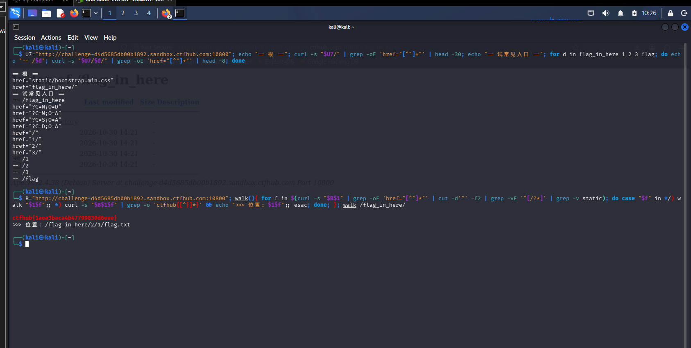

# WP：目录遍历

> **CTFHub 路径**：技能树 → Web → 信息泄露 → 目录遍历
> **任务**：按题目页面提示找到 flag。
> **提示**：注意页面给出的路径和 URL；目录列表本身就是一种信息泄露。只在题目环境内点击和访问，不要使用扫描器扫描其他地址。
> **截图要求**：能看到题目环境地址（或题目名称）、你访问的目录/路径，以及最终的 flag。

---

## 题目信息

| 项目 | 内容 |
| --- | --- |
| 环境地址 | http://challenge-d4d5685db00b1892.sandbox.ctfhub.com:10800/flag_in_here/ |
| Flag | ctfhub{1aea3baca4b47799830d6eee} |

## 解题过程

打开靶场根地址，页面上只有一句 `No Flag here`，看上去像什么都没给，但用 `curl -s` 把 HTML 原样拉下来后，除了引入的 `static/bootstrap.min.css`，还能看到一个相对链接 `flag_in_here/`，说明真正的入口并不在首页正文里，而是在首页的源码里。在浏览器里打开 `/flag_in_here/`，返回的是 Apache 的自动索引页（`Index of /flag_in_here`），表格里列出了 `1/`、`2/`、`3/` 三个子目录，每个目录后面都写着修改时间——这就是典型的目录列表泄露，服务器把目录当成了“可浏览的文件夹”。如果手动点，就要一层一层猜下去，所以我回到终端用 curl 写了个递归：先抓当前目录页面里所有 `href`，过滤掉 `?`、`*` 开头的排序链接、`/` 开头的父目录链接和 `static` 样式表，遇到以 `/` 结尾的就继续往里进，遇到文件就把正文下载下来用 `grep -o 'ctfhub{[^}]*}'` 找 flag。中间还写错过一版：循环里直接请求了根目录下的 `/1/`、`/2/`、`/3/`，而这三个目录其实在 `/flag_in_here/` 下面，所以全部返回 404（Apache 默认 404 页面里没有 `href`，`grep` 什么都不输出，看起来像“命令没反应”）。把起点改成 `/flag_in_here/`、端口改成实际的 `10800` 之后，脚本输出 `>>> 位置: /flag_in_here/2/1/flag.txt`，紧接着就是 `ctfhub{1aea3baca4b47799830d6eee}`。把 flag 提交到题目页面，平台提示正确。

## 关键请求/响应

```http
GET /flag_in_here/ HTTP/1.1
Host: challenge-d4d5685db00b1892.sandbox.ctfhub.com:10800

（响应体为 Apache 自动索引页，关键片段：）
<title>Index of /flag_in_here</title>
<tr><td><a href="1/">1/</a></td><td>2026-10-30 14:21</td></tr>
<tr><td><a href="2/">2/</a></td><td>2026-10-30 14:21</td></tr>
<tr><td><a href="3/">3/</a></td><td>2026-10-30 14:21</td></tr>

GET /flag_in_here/2/1/flag.txt HTTP/1.1
Host: challenge-d4d5685db00b1892.sandbox.ctfhub.com:10800

（响应体：）
ctfhub{1aea3baca4b47799830d6eee}
```

递归遍历用到的命令（Kali 终端，一条即可）：

```bash
B="http://challenge-d4d5685db00b1892.sandbox.ctfhub.com:10800"; walk(){ for f in $(curl -s "$B$1" | grep -oE 'href="[^"]*"' | cut -d'"' -f2 | grep -vE '^[/?*]' | grep -v static); do case "$f" in */) walk "$1$f";; *) curl -s "$B$1$f" | grep -o 'ctfhub{[^}]*}' && echo ">>> 位置: $1$f";; esac; done; }; walk /flag_in_here/
```

## 原理与复盘

这道题利用的是 **请求行里的 URL 路径**：`GET /flag_in_here/2/1/flag.txt HTTP/1.1` 第一个空格后面那一段，就是服务端用来定位文件的全部依据，路径多写几层，文件就被读出来了，全程没有改方法、没有加请求头。目录列表之所以算信息泄露，是因为 Apache 开了 `Indexes`（自动索引）选项后，原本应该返回 403 的目录被当成“文件列表”吐进响应体，服务器上有什么文件、叫什么名字、什么时候改的，全部暴露出来，攻击者不需要扫描器就能顺藤摸瓜找到备份文件、源码、配置文件。复盘有两点：一是首页只放一句 `No Flag here` 是故意误导，真正的线索在 HTML 源码的相对链接里，以后遇到“看起来什么都没有”的页面先看源码；二是写批量脚本时拼路径要以“基线目录”为基准，把下层目录当成根来请求，就会出现整片 404 的假象。

---

## 截图



> 可以在这份 WP 中另加过程截图；检查时只看指定图片，额外图片不检查。
