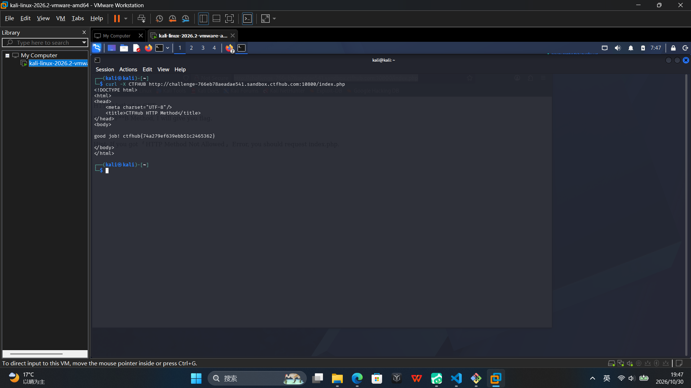

# WP：请求方式

> **CTFHub 路径**：技能树 → Web → Web 前置技能 → HTTP 协议 → 请求方式
> **任务**：按题目要求使用指定的 HTTP 方法访问目标，拿到 flag。
> **提示**：浏览器地址栏默认发送 GET 请求。用 Burp Repeater 修改请求行中的方法，或者用 `curl -X` 复现。
> **截图要求**：优先使用 Burp Repeater，截图中要能看到修改后的请求行（方法 + 路径）和响应中的 flag；如果 Burp 无法启动，可以用 `curl -X` 的方法修改截图代替，并在 WP 中说明原因。只有浏览器普通 GET 访问不算完成。

---

## 题目信息

| 项目 | 内容 |
| --- | --- |
| 环境地址 | http://challenge-766eb78aeadae541.sandbox.ctfhub.com:10800 |
| Flag | ctfhub{74a279ef639ebb51c2465362} |

## 解题过程

我直接用浏览器访问时，页面报错并提示 `HTTP Method Not Allowed`，注释里写着 `Error: you should request index.php`，说明服务器校验的不是路径而是请求方法，而浏览器地址栏只会发 `GET`。于是我改用 `curl -X CTFHUB` 把请求行中的方法改成题目要求的值，重新请求同一个 `/index.php`，页面返回 `good job!` 并带出 flag。本题未使用 Burp Repeater，而是在 Kali 终端用 `curl -X` 直接改写请求行完成（Kali 中未启用 Burp 代理），效果与在 Repeater 中修改请求行等价。

## 关键请求/响应

```http
CTFHUB /index.php HTTP/1.1
Host: challenge-766eb78aeadae541.sandbox.ctfhub.com:10800

<!DOCTYPE html>
<html>
<head>
    <meta charset="UTF-8" />
    <title>CTFHub HTTP Method</title>
</head>
<body>
good job! ctfhub{74a279ef639ebb51c2465362}
</body>
<!-- Hint: If you got "HTTP Method Not Allowed" , Error: you should request index.php. -->
</html>
```

> 说明：`curl` 未加 `-i`，此处响应部分为响应体原文；请求行由 `curl -X CTFHUB` 构造，方法、路径与 HTTP 版本均可从上面的命令行对应确认。

## 原理与复盘

请求行由方法、请求路径和 HTTP 版本三部分组成，三者之间用空格分隔，方法位于请求行最开头。服务器解析请求时先看方法，不认就返回 `405 Method Not Allowed`；本题只接受 `CTFHUB` 这一非标准方法，浏览器发不出来，所以必须改写请求行首段才能通过。这也说明仅靠方法做访问控制并不可靠，因为请求行完全由客户端自行构造。

---

## 截图



> 可以在这份 WP 中另加过程截图；检查时只看指定图片，额外图片不检查。

