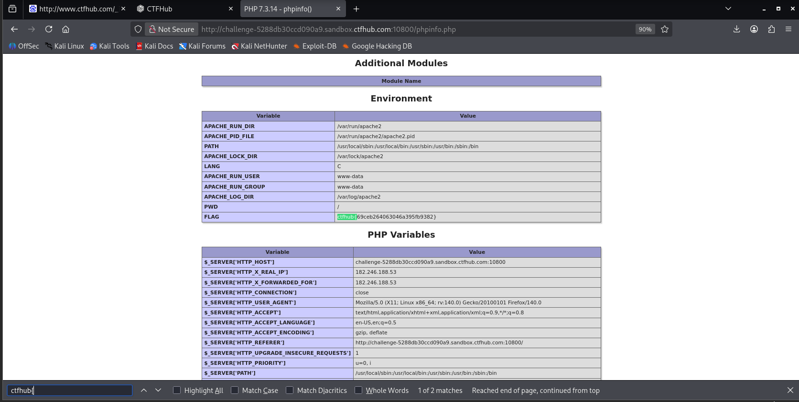

# WP：PHPINFO

> **CTFHub 路径**：技能树 → Web → 信息泄露 → PHPINFO
> **任务**：在 phpinfo 页面中找到 flag，并观察它泄露了哪些信息。
> **提示**：phpinfo 会输出大量 PHP 和服务器配置。用浏览器的查找功能搜索关键字，同时留意页面暴露的路径、版本、环境变量等信息。
> **截图要求**：能看到 phpinfo 页面、你搜索/定位到的 flag，以及至少一处敏感信息。

---

## 题目信息

| 项目 | 内容 |
| --- | --- |
| 环境地址 | http://challenge-5288db30ccd090a9.sandbox.ctfhub.com:10800/phpinfo.php |
| Flag | ctfhub{69ceb264063046a395fb9382} |

## 解题过程

打开靶场根地址时，页面只有一个 `phpinfo` 标题和「点击查看phpinfo」按钮，正文里并不含 flag，真正的 phpinfo 页面在同目录下的 `/phpinfo.php`，访问该路径后才看到完整的配置表格。我先在页面里用 `Ctrl + F` 搜 `ctfhub`，匹配到 12 处，逐一查看后发现全是 `HTTP_HOST`、`HTTP_REFERER` 等变量里的靶场域名，并不是 flag。随后把搜索词改成带花括号的 `ctfhub{`，匹配数降到 2 处，页面直接定位到 `Environment` 区块中的 `FLAG` 变量行，值为 `ctfhub{69ceb264063046a395fb9382}`。同一屏里还能看到 `APACHE_RUN_DIR=/var/run/apache2`、`APACHE_LOG_DIR=/var/log/apache2`、`PWD=/` 等物理路径，浏览器标签页标题也显示了 `PHP 7.3.14`。把 flag 提交到题目页面后，平台提示正确。

## 关键请求/响应

```http
GET /phpinfo.php HTTP/1.1
Host: challenge-5288db30ccd090a9.sandbox.ctfhub.com:10800

HTTP/1.1 200 OK
Server: openresty/1.21.4.2
Date: Fri, 30 Oct 2026 14:05:12 GMT
Content-Type: text/html; charset=UTF-8
Connection: keep-alive
X-Powered-By: PHP/7.3.14

（响应体为 phpinfo 页面，共 81931 字节，在页面中检索到：）
ctfhub{69ceb264063046a395fb9382}
```

## 原理与复盘

phpinfo 原本是开发调试用的页面，会把 PHP 版本、Web 服务器软件及版本、`DOCUMENT_ROOT` 等物理路径、环境变量和请求头原始内容统统打印出来。这些信息对攻击者的价值在于缩小搜索面：版本号可以直接对应到已知漏洞编号，物理路径能用来构造目录穿越或文件包含的路径，环境变量里还可能残留数据库密码、密钥等配置。本题就是利用运维疏忽把 flag 写进环境变量并暴露在 phpinfo 中，说明这类调试页面绝不应该对外开放，上线前必须删除或限制来源 IP 访问。

---

## 截图



> 可以在这份 WP 中另加过程截图；检查时只看指定图片，额外图片不检查。

