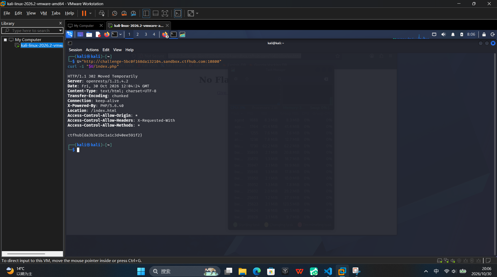

# WP：302 跳转

> **CTFHub 路径**：技能树 → Web → Web 前置技能 → HTTP 协议 → 302 跳转
> **任务**：观察 302 重定向，按题目提示找到 flag。
> **提示**：浏览器通常会自动跟随 302，所以你可能只看到最终页面。打开 DevTools 的 Network 面板（勾选 Preserve log）或 Burp，查看原始响应中的 `302` 状态码和 `Location` 响应头。
> **截图要求**：能看到 302 状态码和/或 `Location` 响应头，以及最终的 flag。只截最终页面、没有 302 证据的截图不合格。

---

## 题目信息

| 项目 | 内容 |
| --- | --- |
| 环境地址 | http://challenge-5bc0f168da132104.sandbox.ctfhub.com:10800 |
| Flag | ctfhub{da3b3e1bc1a1c3d40ee591f2} |

## 解题过程

第一次访问 `/index.html` 时，页面只显示 `No Flag here!` 和一个 `Give me Flag` 链接，浏览器没有出现跳转。我判断真正的跳转发生在链接指向的 `index.php`，于是用 `curl -i` 直接请求该地址，看到响应行是 `HTTP/1.1 302 Moved Temporarily`，响应头中的 `Location` 又指回 `/index.html`，而响应体里已经直接给出了 flag。把 flag 提交到题目页面后，平台提示正确。

## 关键请求/响应

```http
HTTP/1.1 302 Moved Temporarily
Server: openresty/1.21.4.2
Date: Thu, 30 Oct 2026 12:04:24 GMT
Content-Type: text/html; charset=UTF-8
Transfer-Encoding: chunked
Connection: keep-alive
X-Powered-By: PHP/5.6.40
Location: /index.html
Access-Control-Allow-Origin: *
Access-Control-Allow-Headers: X-Requested-With
Access-Control-Allow-Methods: *

ctfhub{da3b3e1bc1a1c3d40ee591f2}
```

## 原理与复盘

200 时浏览器直接渲染响应体；302 本身不带正文，浏览器会读取 Location 再发一次请求，所以人眼看到的是第二个页面的内容，跳转过程被隐藏了

---

## 截图



> 可以在这份 WP 中另加过程截图；检查时只看指定图片，额外图片不检查。

