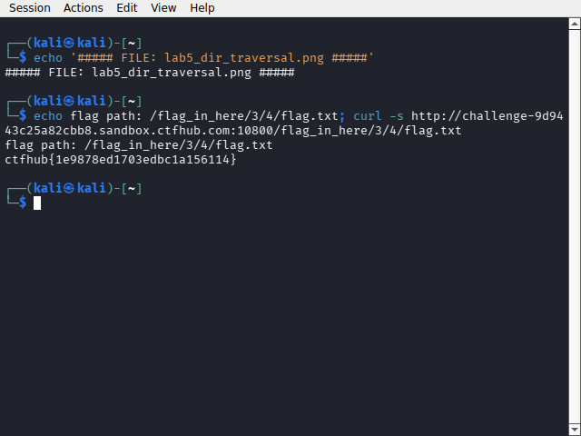

# WP：目录遍历

> **CTFHub 路径**：技能树 → Web → 信息泄露 → 目录遍历
> **任务**：按题目页面提示找到 flag。
> **提示**：注意页面给出的路径和 URL；目录列表本身就是一种信息泄露。只在题目环境内点击和访问，不要使用扫描器扫描其他地址。
> **截图要求**：能看到题目环境地址（或题目名称）、你访问的目录/路径，以及最终的 flag。

---

## 题目信息

| 项目 | 内容 |
| --- | --- |
| 环境地址 | http://challenge-9d9443c25a82cbb8.sandbox.ctfhub.com:10800 |
| Flag | ctfhub{1e9878ed1703edbc1a156114} |

## 解题过程

在 Kali 浏览器里打开靶场，首页只有一行提示和 `static/`、`flag_in_here/` 两个链接，目录列表是 Apache 自动生成的。我先用 `curl -i http://challenge-9d9443c25a82cbb8.sandbox.ctfhub.com:10800/` 确认了首页内容，然后点进 `flag_in_here/`，发现里面又有 `1/`、`2/`、`3/`、`4/` 四个子目录，而且每个子目录下面还套着 `1/`~`4/`，是一棵多层目录树。手点太慢，我在 Kali 终端里用 Python 脚本顺着目录列表逐层抓取链接，最后在 `/flag_in_here/3/4/` 下发现了一个不以 `/` 结尾的文件 `flag.txt`。直接访问这个文件，响应体里就是 flag，回到 CTFHub 提交正确。

## 关键请求/响应

```http
GET /flag_in_here/3/4/flag.txt HTTP/1.1
Host: challenge-9d9443c25a82cbb8.sandbox.ctfhub.com:10800
User-Agent: curl/8.x
Accept: */*

HTTP/1.1 200 OK
Content-Type: text/plain

ctfhub{1e9878ed1703edbc1a156114}
```

目录列表请求的响应片段（`GET /flag_in_here/ HTTP/1.1`，Apache 自动生成的索引页）：

```html
<h1>Index of /flag_in_here/</h1>
<a href="1/">1/</a>  <a href="2/">2/</a>  <a href="3/">3/</a>  <a href="4/">4/</a>
```

## 原理与复盘

这道题对应 HTTP 报文的请求行里的 URL 路径：服务器开启了目录列表（Options Indexes），把目录下的文件和子目录直接列在响应体里返回。攻击者不需要任何漏洞利用工具，只要顺着 URL 路径一层层访问就能枚举出所有文件，相当于把服务器文件清单拱手送人。防御上应该关闭目录索引，并保证敏感文件不在 Web 可访问路径下。

---

## 截图



> 可以在这份 WP 中另加过程截图；检查时只看指定图片，额外图片不检查。
