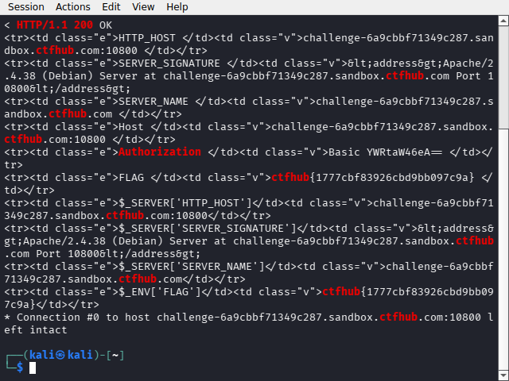

# WP：PHPINFO

> **CTFHub 路径**：技能树 → Web → 信息泄露 → PHPINFO
> **任务**：在 phpinfo 页面中找到 flag，并观察它泄露了哪些信息。
> **提示**：phpinfo 会输出大量 PHP 和服务器配置。用浏览器的查找功能搜索关键字，同时留意页面暴露的路径、版本、环境变量等信息。
> **截图要求**：能看到 phpinfo 页面、你搜索/定位到的 flag，以及至少一处敏感信息。

---

## 题目信息

| 项目 | 内容 |
| --- | --- |
| 环境地址 | http://challenge-6a9cbbf71349c287.sandbox.ctfhub.com:10800 |
| Flag | ctfhub{1777cbf83926cbd9bb097c9a} |

## 解题过程

打开靶场，首页只有一个"点击查看 phpinfo"的链接，指向 `/phpinfo.php`。我用 curl 抓下整个 phpinfo 页面（内容非常长，是 PHP 的完整配置输出），然后在 Kali 终端里用 `grep -iE "ctfhub|flag"` 直接过滤，一眼就看到两行：环境变量表格里有一个名为 `FLAG` 的条目，`$_ENV['FLAG']` 的值也是同一个字符串。flag 就是从环境变量泄露出来的。用 Ctrl+F 在浏览器里搜索定位到同一位置确认后提交，平台提示正确。

## 关键请求/响应

```http
GET /phpinfo.php HTTP/1.1
Host: challenge-6a9cbbf71349c287.sandbox.ctfhub.com:10800

HTTP/1.1 200 OK
Content-Type: text/html; charset=UTF-8
X-Powered-By: PHP/5.6.40

<tr><td class="e">FLAG </td><td class="v">ctfhub{1777cbf83926cbd9bb097c9a} </td></tr>
<tr><td class="e">$_ENV['FLAG']</td><td class="v">ctfhub{1777cbf83926cbd9bb097c9a}</td></tr>
```

## 原理与复盘

phpinfo 页面会把 PHP 版本、编译参数、`$_SERVER`、`$_ENV` 等几乎所有运行时配置输出到响应体里。这些信息对攻击者价值很高：能拿到服务器的绝对路径、操作系统、PHP 版本（可以查已知漏洞）、甚至像本题这样直接把敏感环境变量（可能含数据库密码、API 密钥）打印出来。生产环境绝不应该保留 phpinfo 页面。

---

## 截图



> 可以在这份 WP 中另加过程截图；检查时只看指定图片，额外图片不检查。
