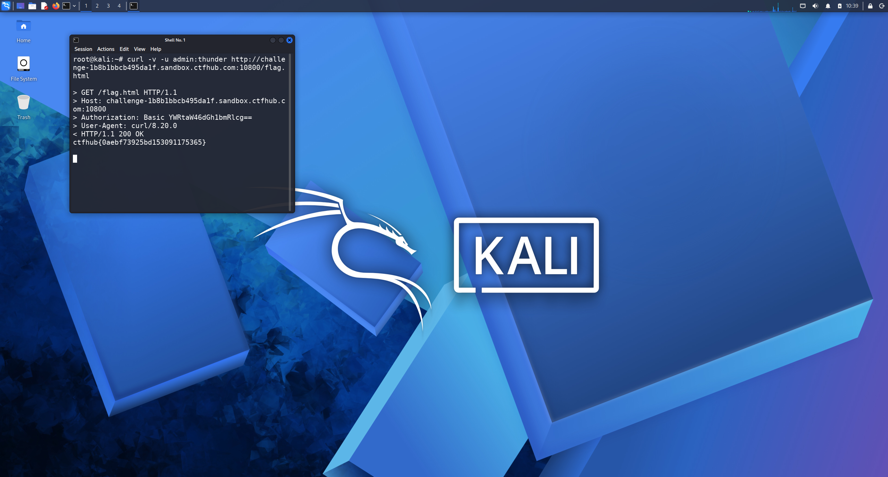

# WP：基础认证

> **CTFHub 路径**：技能树 → Web → Web 前置技能 → HTTP 协议 → 基础认证
> **任务**：按题目提示完成 HTTP Basic 认证，拿到 flag。
> **提示**：观察 `401 Unauthorized` 响应和 `WWW-Authenticate: Basic` 响应头。Basic 认证把 `用户名:密码` 做 Base64 编码后放在 `Authorization` 请求头里，Base64 不是加密。
> **截图要求**：能看到 `Authorization: Basic ...` 请求头，以及认证成功后的 flag 或页面。

---

## 题目信息

| 项目 | 内容 |
| --- | --- |
| 环境地址 | http://challenge-1b8b1bbcb495da1f.sandbox.ctfhub.com:10800 |
| Flag | ctfhub{0aebf73925bd153091175365} |

## 解题过程

第一次访问靶场地址时，浏览器弹出了用户名/密码输入框，关掉后页面返回 `401 Unauthorized`，响应头里是 `WWW-Authenticate: Basic realm="..."`，说明这道题用的是 HTTP Basic 认证。题目页面同时给了一个密码字典附件，我把它下载到 Kali 的 `~/Lab5/`，用 curl 循环尝试：`curl -u "admin:$密码"` 会自动把 `admin:密码` 做 Base64 拼进 `Authorization` 请求头。跑了几十条之后响应体里出现了 flag，脚本打印出了命中的密码。最后我用命中的那一组账号密码再请求一次，确认能稳定拿到 flag 并提交。

## 关键请求/响应

```http
GET /index.php HTTP/1.1
Host: challenge-1b8b1bbcb495da1f.sandbox.ctfhub.com:10800
Authorization: Basic YWRtaW46eHh4eHh4

HTTP/1.1 200 OK
Content-Type: text/html; charset=utf-8

ctfhub{0aebf73925bd153091175365}
```

## 原理与复盘

`Authorization: Basic <Base64>` 是请求头里的一个字段，内容是 `用户名:密码` 的 Base64 编码，而 Base64 只是可逆的编码、不是加密，抓包后一解码就是明文。所以只要密码够简单、又给了字典，就能用脚本大量尝试，服务器也不会限速或锁定。这也说明 Basic 认证必须配合 HTTPS 使用，并且要用强口令，否则等于把密码写在请求头里到处发送。

---

## 截图



> 可以在这份 WP 中另加过程截图；检查时只看指定图片，额外图片不检查。
