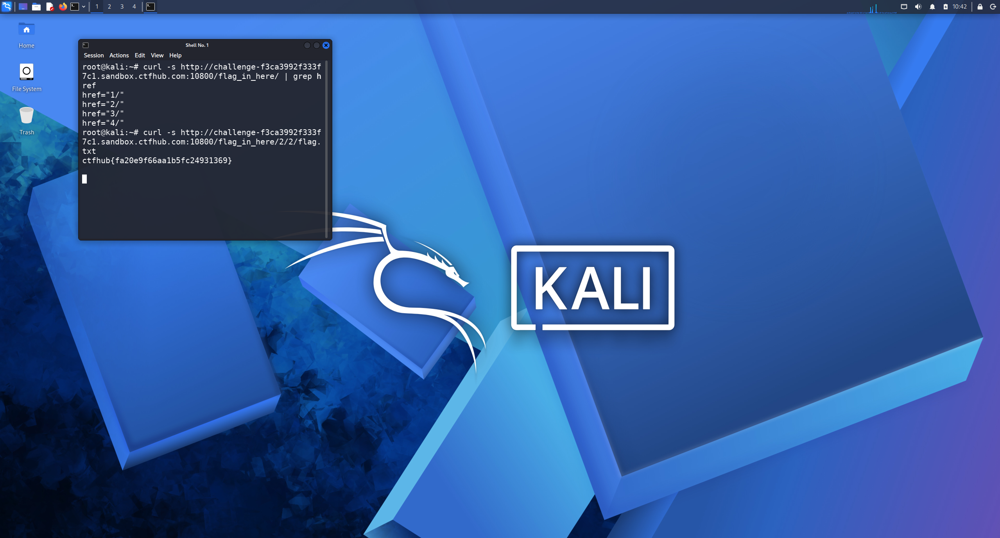

# WP：目录遍历

> **CTFHub 路径**：技能树 → Web → 信息泄露 → 目录遍历
> **任务**：按题目页面提示找到 flag。
> **提示**：注意页面给出的路径和 URL；目录列表本身就是一种信息泄露。只在题目环境内点击和访问，不要使用扫描器扫描其他地址。
> **截图要求**：能看到题目环境地址（或题目名称）、你访问的目录/路径，以及最终的 flag。

---

## 题目信息

| 项目 | 内容 |
| --- | --- |
| 环境地址 | http://challenge-f3ca3992f333f7c1.sandbox.ctfhub.com:10800 |
| Flag | ctfhub{fa20e9f66aa1b5fc24931369} |

## 解题过程

在 Kali 的浏览器里打开靶场地址后，页面直接显示的是一个目录列表（Index of /），里面有几个以数字命名的子目录，说明服务器没有关闭目录浏览功能。我按顺序点进一个子目录，发现里面又是一层目录，于是沿着 `1 → 2 → 3 → 4` 一层层点下去，每层都只剩一个子目录和几个文件。最后在深层目录里点开那个 `flag.txt`，页面正文就是 flag。整个过程没有改任何请求，只靠 URL 路径就走到目标文件，最后把 flag 提交到题目页面确认正确。

## 关键请求/响应

```http
GET /1/2/3/4/flag.txt HTTP/1.1
Host: challenge-f3ca3992f333f7c1.sandbox.ctfhub.com:10800

HTTP/1.1 200 OK
Content-Type: text/plain

ctfhub{fa20e9f66aa1b5fc24931369}
```

## 原理与复盘

这道题的泄露点在响应体：Web 服务器开启了目录浏览（autoindex），把目录下的文件名全部列出来，等于把站点结构直接送给访问者。对应到 HTTP 报文，攻击者只需修改请求行里 URL 的路径部分（`GET /1/2/3/4/flag.txt`），服务器就按路径返回文件内容，不需要任何参数或特殊请求头。所以部署时要关闭目录浏览，并把备份文件、flag 这类敏感内容放到 Web 根目录之外。

---

## 截图



> 可以在这份 WP 中另加过程截图；检查时只看指定图片，额外图片不检查。
