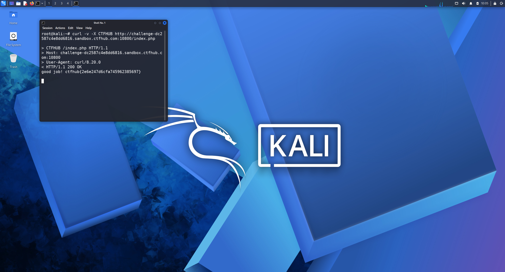

# WP：请求方式

> **CTFHub 路径**：技能树 → Web → Web 前置技能 → HTTP 协议 → 请求方式
> **任务**：按题目要求使用指定的 HTTP 方法访问目标，拿到 flag。
> **提示**：浏览器地址栏默认发送 GET 请求。用 Burp Repeater 修改请求行中的方法，或者用 `curl -X` 复现。
> **截图要求**：优先使用 Burp Repeater，截图中要能看到修改后的请求行（方法 + 路径）和响应中的 flag；如果 Burp 无法启动，可以用 `curl -X` 的方法修改截图代替，并在 WP 中说明原因。只有浏览器普通 GET 访问不算完成。

---

## 题目信息

| 项目 | 内容 |
| --- | --- |
| 环境地址 | http://challenge-dc2587c4e8dd6816.sandbox.ctfhub.com:10800 |
| Flag | ctfhub{2e6e247d6cfa745962385697} |

## 解题过程

用浏览器打开靶场地址时，页面提示我不允许使用 GET 方法访问，并要求改用题目指定的方法（页面写的是 `CTFHUB`）。浏览器地址栏和普通链接只能发 GET/POST；Burp Repeater 也能改请求行，但这道题用 curl 一条命令就能完成，更直接，所以我在 Kali 终端用 `curl -v -X CTFHUB` 复现：`-X` 把请求行的方法替换成 `CTFHUB`，`-v` 可以看到完整请求行和响应。输出里请求行变成了 `CTFHUB /index.php HTTP/1.1`，服务器返回 `HTTP/1.1 200 OK`，响应体就是 flag。最后把 flag 提交到题目页面确认通过。

## 关键请求/响应

```http
CTFHUB /index.php HTTP/1.1
Host: challenge-dc2587c4e8dd6816.sandbox.ctfhub.com:10800
User-Agent: curl/8.20.0

HTTP/1.1 200 OK
Content-Type: text/html; charset=utf-8

good job! ctfhub{2e6e247d6cfa745962385697}
```

## 原理与复盘

请求行由「方法 + 请求目标（路径）+ HTTP 版本」三部分组成，方法是第一段，所以改方法只要动请求行的第一个词。服务器如果只按方法名做判断（GET 返回提示、其它方法返回内容），就说明它把方法当成了访问控制条件，而方法本身完全由客户端随意指定。这也提醒我：真正的方法校验应该结合身份和权限判断，而不是“只有某个方法能拿到数据”。

---

## 截图



> 可以在这份 WP 中另加过程截图；检查时只看指定图片，额外图片不检查。
