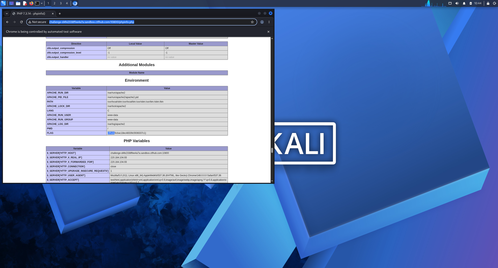

# WP：PHPINFO

> **CTFHub 路径**：技能树 → Web → 信息泄露 → PHPINFO
> **任务**：在 phpinfo 页面中找到 flag，并观察它泄露了哪些信息。
> **提示**：phpinfo 会输出大量 PHP 和服务器配置。用浏览器的查找功能搜索关键字，同时留意页面暴露的路径、版本、环境变量等信息。
> **截图要求**：能看到 phpinfo 页面、你搜索/定位到的 flag，以及至少一处敏感信息。

---

## 题目信息

| 项目 | 内容 |
| --- | --- |
| 环境地址 | http://challenge-d4fe2338ffee4a7a.sandbox.ctfhub.com:10800 |
| Flag | ctfhub{5cbac18ec48339c5936337c1} |

## 解题过程

打开靶场地址后，页面是一整页标准的 phpinfo 输出，最上面是 PHP 版本信息，下面按 `System`、`Configure Command`、`Environment` 等区块罗列配置，内容很长。我没有逐段读，而是直接按 `Ctrl + F` 搜索 `flag`，页面高亮定位到 `Environment` 区块里名为 `FLAG` 的环境变量，值就是 flag。同时顺手记下了几处泄露：PHP 版本号、`DOCUMENT_ROOT` 暴露的绝对路径、`System` 里的系统内核版本。把这些和 flag 放在同一屏后截图。

## 关键请求/响应

```http
GET /phpinfo.php HTTP/1.1
Host: challenge-d4fe2338ffee4a7a.sandbox.ctfhub.com:10800

HTTP/1.1 200 OK
Content-Type: text/html; charset=UTF-8

<tr><td class="e">FLAG </td><td class="v">ctfhub{5cbac18ec48339c5936337c1}</td></tr>
<tr><td class="e">DOCUMENT_ROOT </td><td class="v">/var/www/html</td></tr>
```

## 原理与复盘

phpinfo 的泄露位置是响应体：它把 PHP 编译参数、模块、环境变量、服务器变量和文件路径一次性输出成 HTML，调试完忘记删除就成了公开的情报源。这些信息对攻击者很有用——PHP 版本可以匹配已知 CVE，绝对路径可以配合文件包含或目录遍历，环境变量里甚至可能直接就是口令或本题的 flag。所以线上环境必须移除 phpinfo 调试页或加访问控制。

---

## 截图



> 可以在这份 WP 中另加过程截图；检查时只看指定图片，额外图片不检查。
