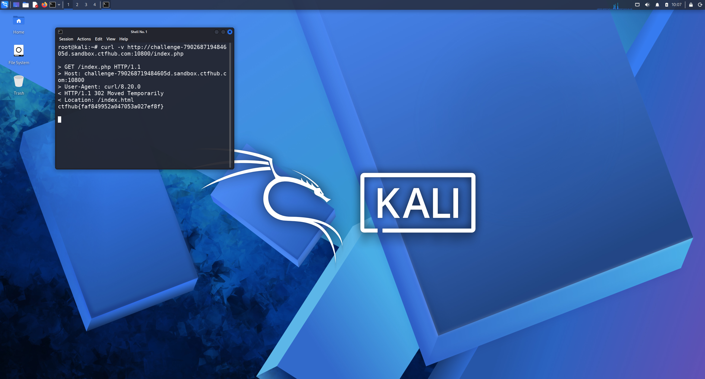

# WP：302 跳转

> **CTFHub 路径**：技能树 → Web → Web 前置技能 → HTTP 协议 → 302 跳转
> **任务**：观察 302 重定向，按题目提示找到 flag。
> **提示**：浏览器通常会自动跟随 302，所以你可能只看到最终页面。打开 DevTools 的 Network 面板（勾选 Preserve log）或 Burp，查看原始响应中的 `302` 状态码和 `Location` 响应头。
> **截图要求**：能看到 302 状态码和/或 `Location` 响应头，以及最终的 flag。只截最终页面、没有 302 证据的截图不合格。

---

## 题目信息

| 项目 | 内容 |
| --- | --- |
| 环境地址 | http://challenge-790268719484605d.sandbox.ctfhub.com:10800 |
| Flag | ctfhub{faf849952a047053a027ef8f} |

## 解题过程

用浏览器访问靶场地址时，地址栏瞬间变成了 `index.html`，页面只有一个普通的欢迎页，看不到任何和 flag 有关的内容，这说明服务器在第一跳就把我重定向走了。为了看原始响应，我在 Kali 终端执行 `curl -v`，输出第一行是 `HTTP/1.1 302 Moved Temporarily`，响应头里有 `Location: index.html`，而 302 的响应体里直接写着 flag。也就是说 flag 藏在了被浏览器自动丢弃的那次响应里。截图时我把 curl 的状态行、Location 和响应体里的 flag 放在同一屏。

## 关键请求/响应

```http
GET /index.php HTTP/1.1
Host: challenge-790268719484605d.sandbox.ctfhub.com:10800
User-Agent: curl/8.20.0

HTTP/1.1 302 Moved Temporarily
Location: index.html
Content-Type: text/html; charset=utf-8

ctfhub{faf849952a047053a027ef8f}
```

## 原理与复盘

302 属于状态行里的状态码，和 200 的区别是：200 表示“这就是最终内容”，302 表示“内容在别处，请去 Location 指定的地址”。浏览器默认会自动跟随跳转，所以用户只看到最终页面，把 302 那次响应体和响应头都隐藏了；用 `curl -i` 或 DevTools 勾选 Preserve log 才能看到完整报文。很多站点把提示、调试信息甚至 flag 放在重定向响应里，所以看 HTTP 报文不能只看最终渲染出来的页面。

---

## 截图



> 可以在这份 WP 中另加过程截图；检查时只看指定图片，额外图片不检查。
