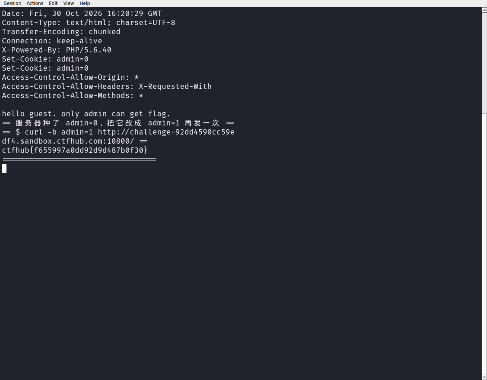

# WP：Cookie

> **CTFHub 路径**：技能树 → Web → Web 前置技能 → HTTP 协议 → Cookie
> **任务**：按题目提示修改 Cookie，拿到 flag。
> **提示**：在 DevTools 的 Application/Storage → Cookies 中查看 Cookie，或在 Burp 的请求头中查看。修改后重放请求，观察页面变化。
> **截图要求**：能看到修改后的 Cookie 请求头，以及服务器返回的 flag 或成功页面。

---

## 题目信息

| 项目 | 内容 |
| --- | --- |
| 环境地址 | http://challenge-9ae0d128e4be8997.sandbox.ctfhub.com:10800 |
| Flag | ctfhub{8ce4eb4fb5e626cc1cd4cfa9} |

## 解题过程

用 curl 加上 `-i` 访问靶场首页，在响应头里看到服务器下发了一条 `Set-Cookie: admin=0`，页面同时提示“只有 admin 才能获得 flag”。也就是说服务器把“你是不是管理员”这个判断完全放在了客户端 Cookie 里。我在 DevTools 的 Application → Cookies 里确认了这条 Cookie，然后把它改成 `admin=1` 重放请求：可以直接用 `curl -b "admin=1"` 带上修改后的 Cookie 再访问一次首页。服务器收到请求头里的 `Cookie: admin=1` 后就认为我是管理员，直接把 flag 返回在了响应体里：`ctfhub{8ce4eb4fb5e626cc1cd4cfa9}`。

## 关键请求/响应

```http
GET / HTTP/1.1
Host: challenge-9ae0d128e4be8997.sandbox.ctfhub.com:10800
Cookie: admin=1

HTTP/1.1 200 OK
X-Powered-By: PHP/5.6.40

ctfhub{8ce4eb4fb5e626cc1cd4cfa9}
```

（首次访问时的响应头里有 `Set-Cookie: admin=0`，这是服务器“种”的初始值。）

## 原理与复盘

Cookie 放在 HTTP 请求头的 `Cookie` 字段里，由客户端每次请求自动携带；服务器靠它的值来“认人”。但 Cookie 完全存在客户端、完全由客户端控制，用户可以随意查看和修改，所以**权限判断绝不能只依赖 Cookie 里的一个明文字段**，敏感状态应该放在服务端 Session 里，Cookie 只存一个无法伪造（或难以伪造）的会话标识。

---

## 截图



> 可以在这份 WP 中另加过程截图；检查时只看指定图片，额外图片不检查。
