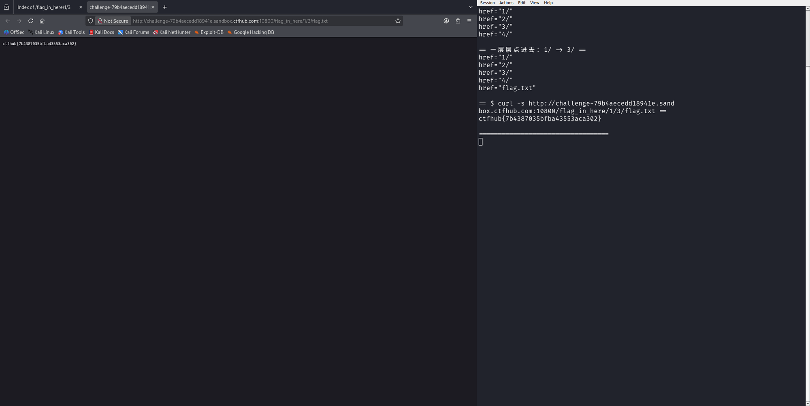

# WP：目录遍历

> **CTFHub 路径**：技能树 → Web → 信息泄露 → 目录遍历
> **任务**：按题目页面提示找到 flag。
> **提示**：注意页面给出的路径和 URL；目录列表本身就是一种信息泄露。只在题目环境内点击和访问，不要使用扫描器扫描其他地址。
> **截图要求**：能看到题目环境地址（或题目名称）、你访问的目录/路径，以及最终的 flag。

---

## 题目信息

| 项目 | 内容 |
| --- | --- |
| 环境地址 | http://challenge-79b4aecedd18941e.sandbox.ctfhub.com:10800 |
| Flag | ctfhub{7b4387035bfba43553aca302} |

## 解题过程

在 Kali 的 Firefox 里打开靶场地址，首页只有一个标题“目录遍历”和一个按钮，按钮的链接指向 `/flag_in_here/`。访问这个目录后，服务器直接把目录下的内容列了出来：有 `1/`、`2/`、`3/`、`4/` 四个子目录，这本身就是一种信息泄露。我按照“点击开始寻找 flag”的提示一层层点进去，先看 `1/`，里面又列出了 `1/`、`2/`、`3/`，继续进入 `1/3/`，终于看到了一个 `flag.txt` 文件。最后在浏览器里直接访问 `/flag_in_here/1/3/flag.txt`，页面返回了 flag：`ctfhub{7b4387035bfba43553aca302}`。

## 关键请求/响应

```http
GET /flag_in_here/1/3/flag.txt HTTP/1.1
Host: challenge-79b4aecedd18941e.sandbox.ctfhub.com:10800

HTTP/1.1 200 OK
Content-Type: text/plain

ctfhub{7b4387035bfba43553aca302}
```

访问 `/flag_in_here/` 和 `/flag_in_here/1/` 时，服务器返回的是 Apache 自动生成的目录列表页面（`Index of /flag_in_here/...`），把子目录和文件直接列了出来，没有做任何访问控制。

## 原理与复盘

这道题对应 HTTP 报文里的 **URL 路径**部分：Web 服务器开启了目录列表（autoindex），任何人只要猜到或看到目录路径，就能像浏览文件夹一样一层层翻。目录列表会把备份文件、源码、配置文件、后台入口等敏感内容直接暴露给攻击者。生产环境应该关闭目录浏览（Apache 去掉 `Options +Indexes`），敏感文件也不要放在 Web 可访问目录下。

---

## 截图



> 可以在这份 WP 中另加过程截图；检查时只看指定图片，额外图片不检查。
