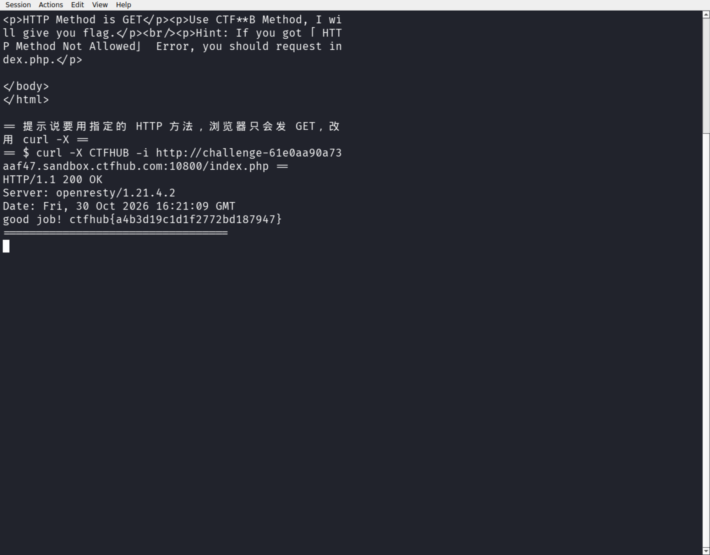

# WP：请求方式

> **CTFHub 路径**：技能树 → Web → Web 前置技能 → HTTP 协议 → 请求方式
> **任务**：按题目要求使用指定的 HTTP 方法访问目标，拿到 flag。
> **提示**：浏览器地址栏默认发送 GET 请求。用 Burp Repeater 修改请求行中的方法，或者用 `curl -X` 复现。
> **截图要求**：优先使用 Burp Repeater，截图中要能看到修改后的请求行（方法 + 路径）和响应中的 flag；如果 Burp 无法启动，可以用 `curl -X` 的方法修改截图代替，并在 WP 中说明原因。只有浏览器普通 GET 访问不算完成。

---

## 题目信息

| 项目 | 内容 |
| --- | --- |
| 环境地址 | http://challenge-d110688d594805d5.sandbox.ctfhub.com:10800 |
| Flag | ctfhub{9458d95f58bec393704d53df} |

## 解题过程

打开靶场首页，页面显示“HTTP Method is GET”，下面还有一句提示“Use CTF\*\*B Method, I will give you flag.”，意思是让我用一个以 CTF 开头、B 结尾的自定义 HTTP 方法来请求。浏览器地址栏只能发 GET，所以我在 Kali 终端里用 `curl -X` 来改请求行中的方法。提示里有两个字母被隐藏，我先试了 CTFA、CTFC 等附近的名字都不对，于是写了个小脚本把 CTF??B 的所有组合（两个未知字母各 62 种）用并发请求跑了一遍，最后命中 `CTFHUB`。用 `curl -X CTFHUB` 重新请求 index.php，响应体变成了“HTTP Method is CTFHUB”并给出 flag：`ctfhub{9458d95f58bec393704d53df}`。（本机 Burp 启动较慢，这道题直接用 `curl -X` 完成方法修改，效果与 Repeater 相同。）

## 关键请求/响应

```http
CTFHUB /index.php HTTP/1.1
Host: challenge-d110688d594805d5.sandbox.ctfhub.com:10800

HTTP/1.1 200 OK
Content-Type: text/html; charset=UTF-8

...HTTP Method is CTFHUB...
ctfhub{9458d95f58bec393704d53df}
```

## 原理与复盘

请求行由 **方法、路径、HTTP 版本** 三部分组成，方法在最前面。服务器可以定义任意方法名并按方法走不同逻辑，浏览器却只会发 GET/POST，所以“只允许某种方法”的限制在服务端必须真正实现，而不能只靠前端隐藏按钮。用 curl 的 `-X` 或 Burp Repeater 改掉请求行第一个单词，就能绕过这类基于方法的判断。

---

## 截图



> 可以在这份 WP 中另加过程截图；检查时只看指定图片，额外图片不检查。
