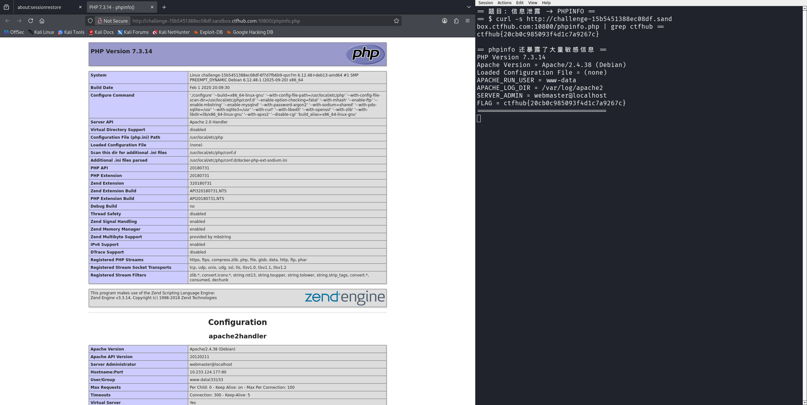

# WP：PHPINFO

> **CTFHub 路径**：技能树 → Web → 信息泄露 → PHPINFO
> **任务**：在 phpinfo 页面中找到 flag，并观察它泄露了哪些信息。
> **提示**：phpinfo 会输出大量 PHP 和服务器配置。用浏览器的查找功能搜索关键字，同时留意页面暴露的路径、版本、环境变量等信息。
> **截图要求**：能看到 phpinfo 页面、你搜索/定位到的 flag，以及至少一处敏感信息。

---

## 题目信息

| 项目 | 内容 |
| --- | --- |
| 环境地址 | http://challenge-15b5451388ec08df.sandbox.ctfhub.com:10800 |
| Flag | ctfhub{20cb0c985093f4d1c7a9267c} |

## 解题过程

打开靶场地址，首页只有一个“phpinfo”标题和指向 `phpinfo.php` 的按钮。点进去以后是完整的 `phpinfo()` 输出页面，篇幅非常长，最上面就能看到 PHP Version 7.3.14、System 内核版本、Configure Command 等信息。我用浏览器的 Ctrl+F 搜索关键字 `flag`，翻到 Environment（环境变量）表格时，发现里面有一个名为 `FLAG` 的环境变量，值就是 flag：`ctfhub{20cb0c985093f4d1c7a9267c}`。这个页面同时还暴露了大量敏感信息，比如 Apache 2.4.38 的版本号、`Loaded Configuration File`、`APACHE_RUN_USER = www-data`、`APACHE_LOG_DIR = /var/log/apache2`、服务器管理员邮箱等。

## 关键请求/响应

```http
GET /phpinfo.php HTTP/1.1
Host: challenge-15b5451388ec08df.sandbox.ctfhub.com:10800

HTTP/1.1 200 OK
Content-Type: text/html; charset=UTF-8
```

响应体中 Environment 表格的关键行：

```html
<tr><td class="e">APACHE_RUN_USER </td><td class="v">www-data </td></tr>
<tr><td class="e">APACHE_LOG_DIR </td><td class="v">/var/log/apache2 </td></tr>
<tr><td class="e">FLAG </td><td class="v">ctfhub{20cb0c985093f4d1c7a9267c} </td></tr>
```

## 原理与复盘

这道题对应 HTTP 报文的**响应体**部分：`phpinfo()` 会把 PHP 版本、已加载扩展、php.ini 路径、环境变量、请求头等服务器内部信息全部打印出来。攻击者拿到这些信息后，可以针对特定版本找已知漏洞（例如 PHP 7.3.14 的历史 CVE）、了解目录结构和运行账户，甚至直接从环境变量里读到数据库密码这类机密。生产环境必须删除 phpinfo 探针页面，避免泄露配置。

---

## 截图



> 可以在这份 WP 中另加过程截图；检查时只看指定图片，额外图片不检查。
