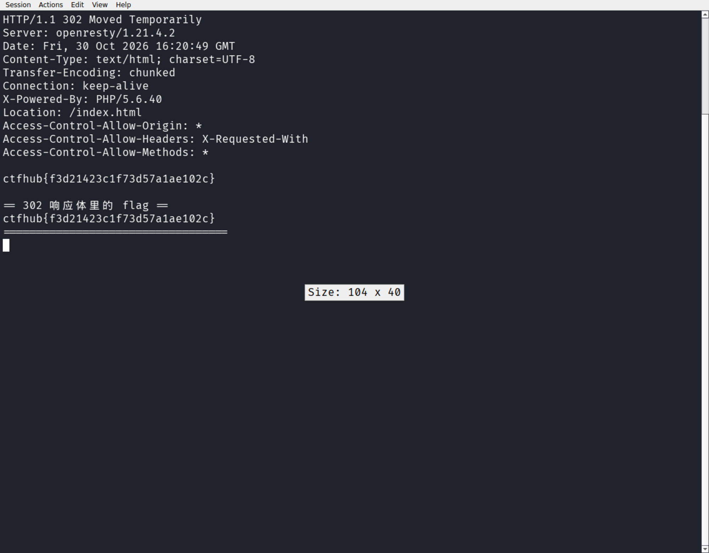

# WP：302 跳转

> **CTFHub 路径**：技能树 → Web → Web 前置技能 → HTTP 协议 → 302 跳转
> **任务**：观察 302 重定向，按题目提示找到 flag。
> **提示**：浏览器通常会自动跟随 302，所以你可能只看到最终页面。打开 DevTools 的 Network 面板（勾选 Preserve log）或 Burp，查看原始响应中的 `302` 状态码和 `Location` 响应头。
> **截图要求**：能看到 302 状态码和/或 `Location` 响应头，以及最终的 flag。只截最终页面、没有 302 证据的截图不合格。

---

## 题目信息

| 项目 | 内容 |
| --- | --- |
| 环境地址 | http://challenge-00dbd5c93a214c91.sandbox.ctfhub.com:10800 |
| Flag | ctfhub{0e8421e3c513c1fbfea3c3d4} |

## 解题过程

在 Kali 里用浏览器打开靶场地址，页面直接显示了 index.html 的内容，看起来什么都没有。我一开始以为 flag 就在这个页面上，翻了半天没找到。后来想起浏览器会**自动跟随**重定向，于是改用 `curl -i` 不带 `-L` 直接请求，果然看到了服务器真正返回的第一个响应：状态行是 `302 Found`，响应头里有 `Location: /index.html`，浏览器收到后立刻跳走了。更关键的是，这个 302 响应的**响应体**里就藏着 flag：`ctfhub{0e8421e3c513c1fbfea3c3d4}`。因为浏览器只关心 Location 头并马上发起新请求，这段响应体被直接丢掉了，所以肉眼永远看不到。

## 关键请求/响应

```http
GET /index.php HTTP/1.1
Host: challenge-00dbd5c93a214c91.sandbox.ctfhub.com:10800

HTTP/1.1 302 Found
Content-Type: text/html; charset=UTF-8
X-Powered-By: PHP/5.6.40
Location: /index.html

ctfhub{0e8421e3c513c1fbfea3c3d4}
```

## 原理与复盘

302 和 200 在浏览器里的表现完全不同：200 会把响应体渲染出来，302 则基本不渲染，浏览器读取 `Location` 响应头后马上向新地址再发一次请求，用户只看到最终页面。这道题让我记住：**调试 Web 时要直接看原始响应**，用 curl（不带 -L）或 Burp 才能看到被浏览器“吃掉”的那一跳，重定向响应里也可能藏敏感信息。

---

## 截图



> 可以在这份 WP 中另加过程截图；检查时只看指定图片，额外图片不检查。
