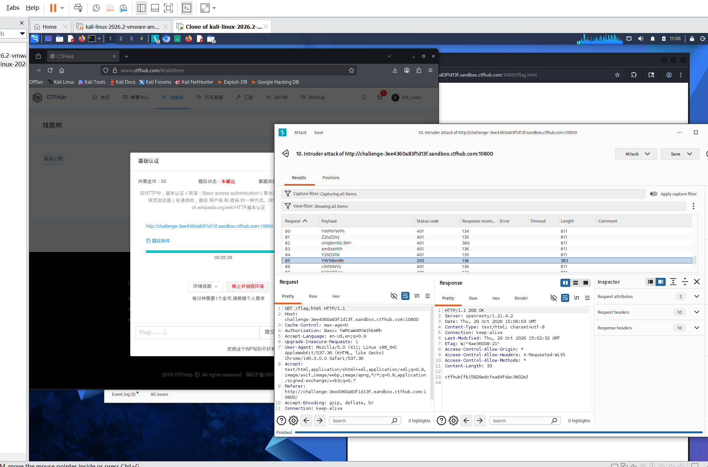

# WP：基础认证

> **CTFHub 路径**：技能树 → Web → Web 前置技能 → HTTP 协议 → 基础认证
> **任务**：按题目提示完成 HTTP Basic 认证，拿到 flag。
> **提示**：观察 `401 Unauthorized` 响应和 `WWW-Authenticate: Basic` 响应头。Basic 认证把 `用户名:密码` 做 Base64 编码后放在 `Authorization` 请求头里，Base64 不是加密。
> **截图要求**：能看到 `Authorization: Basic ...` 请求头，以及认证成功后的 flag 或页面。

---

## 题目信息

| 项目 | 内容 |
| --- | --- |
| 环境地址 | http://challenge-3ee4360a83f1d13f.sandbox.ctfhub.com:10800/flag.html |
| Flag | ctfhub{fb15829edcfea64fdac3602e} |

## 解题过程

第一次访问 `/flag.html`，浏览器直接弹出登录框，Burp 里对应的响应是 `401 Unauthorized`，并带着 `WWW-Authenticate: Basic` 响应头，说明这是 HTTP Basic 认证，凭据要放在 `Authorization` 请求头里。题目给了用户名字段，密码需要自己试，所以我把这条请求发到 **Intruder**，把 `Authorization: Basic YWRtaW46§payload§` 里的 payload 位置设成密码字典（字典里是各候选密码的 Base64 值），开始爆破。第 85 条 payload `YWRtaW4h` 返回 `200`，其余都是 401，说明密码是 `admin!`。最终请求的完整请求头是 `Authorization: Basic YWRtaW46YWRtaW4h`，响应正文就是 flag，复制回平台提交提示正确。

## 关键请求/响应

```http
GET /flag.html HTTP/1.1
Host: challenge-3ee4360a83f1d13f.sandbox.ctfhub.com:10800
User-Agent: Mozilla/5.0 (X11; Linux x86_64; rv:128.0) Gecko/20100101 Firefox/128.0
Accept: text/html,application/xhtml+xml,application/xml;q=0.9,*/*;q=0.8
Authorization: Basic YWRtaW46YWRtaW4h
Connection: close

HTTP/1.1 200 OK
Server: openresty/1.21.4.2
Content-Type: text/html; charset=utf-8
Content-Length: 33

ctfhub{fb15829edcfea64fdac3602e}
```

其中 `YWRtaW46YWRtaW4h` 解 Base64 就是 `admin:admin!`；认证失败时服务器返回 `401 Unauthorized` + `WWW-Authenticate: Basic`，成功才返回 200 和 flag。

## 原理与复盘

Basic 认证把 `用户名:密码` 用冒号拼起来，整体做 **Base64 编码**，再写进**请求头** `Authorization: Basic <base64>`，所以它放在请求头而不是 URL 或请求体里。Base64 只是编码不是加密，任何人都能一眼解回明文，因此这题能靠字典爆破；即使加了 HTTPS，Basic 认证也建议配合其他机制使用。另外 401 和 `WWW-Authenticate` 是服务器在告诉客户端“需要认证、用哪种方式认证”，这也是判断认证类型的直接证据。

---

## 截图



> 可以在这份 WP 中另加过程截图；检查时只看指定图片，额外图片不检查。
