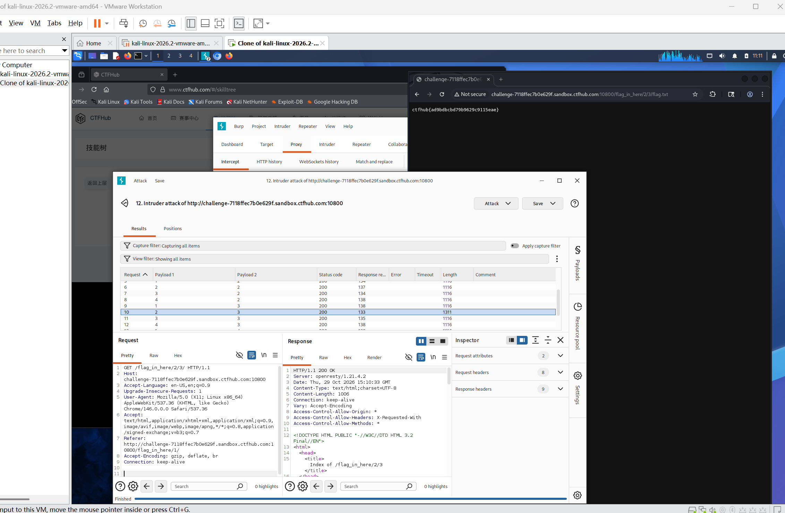

# WP：目录遍历

> **CTFHub 路径**：技能树 → Web → 信息泄露 → 目录遍历
> **任务**：按题目页面提示找到 flag。
> **提示**：注意页面给出的路径和 URL；目录列表本身就是一种信息泄露。只在题目环境内点击和访问，不要使用扫描器扫描其他地址。
> **截图要求**：能看到题目环境地址（或题目名称）、你访问的目录/路径，以及最终的 flag。

---

## 题目信息

| 项目 | 内容 |
| --- | --- |
| 环境地址 | http://challenge-7118ffec7b0e629f.sandbox.ctfhub.com:10800/ |
| Flag | ctfhub{ad9bdbcbd79b9629c9115eae} |

## 解题过程

开启题目后，首页只有一个 `flag_in_here` 的目录链接，说明 flag 藏在这层目录里面。点进去后服务器没有返回首页，而是直接把目录下的内容列了出来，看到 1、2、3、4 四个数字子目录。我按 2 → 3 的顺序一层层点下去，每一层都还是目录列表，在最后一层里看到一个 `flag.txt`。点开它，页面直接显示出 flag。回到题目页面提交，平台提示正确。

## 关键请求/响应

```http
GET /flag_in_here/2/3/flag.txt HTTP/1.1
Host: challenge-7118ffec7b0e629f.sandbox.ctfhub.com:10800
User-Agent: Mozilla/5.0 (X11; Linux x86_64; rv:128.0) Gecko/20100101 Firefox/128.0
Accept: text/html,application/xhtml+xml,application/xml;q=0.9,*/*;q=0.8

HTTP/1.1 200 OK
Content-Type: text/plain; charset=utf-8

ctfhub{ad9bdbcbd79b9629c9115eae}
```

本题不需要修改请求，只是把浏览器地址栏里的路径改成目录列表里显示的路径。

## 原理与复盘

这道题的入口在 HTTP **请求行的 URL 路径**，结果在**响应体**：服务器对 `/flag_in_here/` 开启了目录列表（autoindex），把目录里有什么文件直接写进 HTML 返回给浏览器。目录列表本身不是漏洞利用，但它把“本该隐藏的文件”变成了可枚举的路径，再配合敏感文件放在 Web 根目录下，flag（或者备份文件、源码）就会被直接下载。防御上应该关掉目录浏览，并把敏感文件移出 Web 目录。

---

## 截图



> 可以在这份 WP 中另加过程截图；检查时只看指定图片，额外图片不检查。
