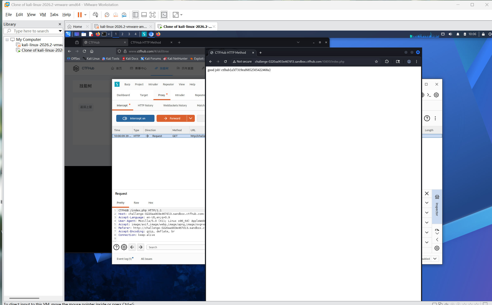

# WP：请求方式

> **CTFHub 路径**：技能树 → Web → Web 前置技能 → HTTP 协议 → 请求方式
> **任务**：按题目要求使用指定的 HTTP 方法访问目标，拿到 flag。
> **提示**：浏览器地址栏默认发送 GET 请求。用 Burp Repeater 修改请求行中的方法，或者用 `curl -X` 复现。
> **截图要求**：优先使用 Burp Repeater，截图中要能看到修改后的请求行（方法 + 路径）和响应中的 flag；如果 Burp 无法启动，可以用 `curl -X` 的方法修改截图代替，并在 WP 中说明原因。只有浏览器普通 GET 访问不算完成。

---

## 题目信息

| 项目 | 内容 |
| --- | --- |
| 环境地址 | http://challenge-0220aa903e467d13.sandbox.ctfhub.com:10800/index.php |
| Flag | ctfhub{a5f7319eaf6852505422468a} |

## 解题过程

用浏览器打开靶场首页，请求方式是地址栏默认的 GET，页面只返回一句提示，要求换用题目指定的 `CTFHub` 方法访问，所以光靠浏览器永远拿不到 flag。我把 Kali 浏览器挂上 Burp 代理，在 **Proxy → HTTP history** 里找到这条 `GET /index.php` 请求，右键 **Send to Repeater**。在 Repeater 里只改请求行的第一个单词，把 `GET` 换成 `CTFHub`，路径和 HTTP 版本不动，点 **Send**。响应变成了 `200 OK`，正文是 `good job! ctfhub{a5f7319eaf6852505422468a}`。复制 flag 回平台提交，提示正确。

## 关键请求/响应

```http
CTFHub /index.php HTTP/1.1
Host: challenge-0220aa903e467d13.sandbox.ctfhub.com:10800
User-Agent: Mozilla/5.0 (X11; Linux x86_64; rv:128.0) Gecko/20100101 Firefox/128.0
Accept: text/html,application/xhtml+xml,application/xml;q=0.9,*/*;q=0.8
Connection: close

HTTP/1.1 200 OK
Content-Type: text/html; charset=UTF-8

good job! ctfhub{a5f7319eaf6852505422468a}
```

等价的命令行复现（Kali 终端）：`curl -X CTFHub http://challenge-0220aa903e467d13.sandbox.ctfhub.com:10800/index.php`。

## 原理与复盘

请求行由三部分组成：**方法 + 请求目标（路径）+ HTTP 版本**，中间用空格隔开，例如 `CTFHub /index.php HTTP/1.1`，方法就在请求行的最前面、第一个空格之前。HTTP 规范并没有把方法限定为 GET/POST，服务端完全可以自定义方法名并只在收到该方法时才返回内容，所以这里把方法改成 `CTFHub` 就能过。浏览器只发 GET/POST，因此必须借助 Burp 或 curl 才能改请求行。

---

## 截图



> 可以在这份 WP 中另加过程截图；检查时只看指定图片，额外图片不检查。
