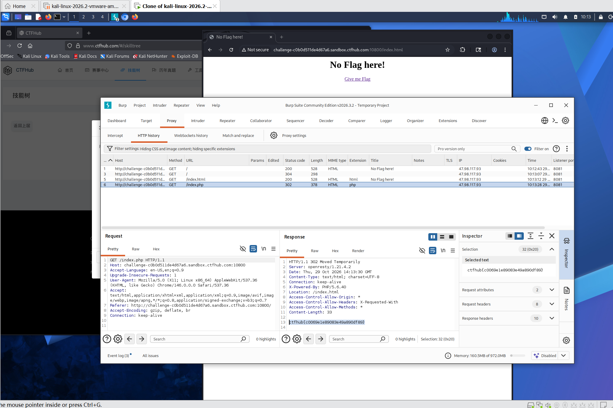

# WP：302 跳转

> **CTFHub 路径**：技能树 → Web → Web 前置技能 → HTTP 协议 → 302 跳转
> **任务**：观察 302 重定向，按题目提示找到 flag。
> **提示**：浏览器通常会自动跟随 302，所以你可能只看到最终页面。打开 DevTools 的 Network 面板（勾选 Preserve log）或 Burp，查看原始响应中的 `302` 状态码和 `Location` 响应头。
> **截图要求**：能看到 302 状态码和/或 `Location` 响应头，以及最终的 flag。只截最终页面、没有 302 证据的截图不合格。

---

## 题目信息

| 项目 | 内容 |
| --- | --- |
| 环境地址 | http://challenge-c0b0d511de4d67a6.sandbox.ctfhub.com:10800/ |
| Flag | ctfhub{c0069e1e89083e49a890df89} |

## 解题过程

第一次用浏览器访问 `/index.php`，地址栏自己变成了 `/index.html`，页面只有一个 `No Flag here!` 和一句“Give me flag”，页面里根本没有 flag。这说明中间发生了一次重定向，只是浏览器替我走完了。我打开 Burp 的 **HTTP history**，看到 `GET /index.php` 的原始响应状态行是 `302 Found`，带一个 `Location: /index.html` 响应头；再点开 Response 的正文，flag 其实就写在这次 302 的响应体里（`Content-Length: 33`），浏览器因为直接跳走所以没显示。把这段正文里的 flag 复制出来提交，平台提示正确。

## 关键请求/响应

```http
GET /index.php HTTP/1.1
Host: challenge-c0b0d511de4d67a6.sandbox.ctfhub.com:10800
User-Agent: Mozilla/5.0 (X11; Linux x86_64; rv:128.0) Gecko/20100101 Firefox/128.0
Accept: text/html,application/xhtml+xml,application/xml;q=0.9,*/*;q=0.8

HTTP/1.1 302 Found
Location: /index.html
Content-Type: text/html; charset=utf-8
Content-Length: 33

ctfhub{c0069e1e89083e49a890df89}
```

本题不需要修改请求，只需要在 Burp（或 DevTools 勾选 Preserve log）里查看原始响应。

## 原理与复盘

200 表示服务器直接把内容给浏览器，浏览器原样渲染；302 表示“内容不在我这儿，去 `Location` 指的地址拿”，浏览器会自动再发一次请求，所以我们只看到最终页面，中间这次 302 的响应体被丢掉了。这题的关键证据是**状态行 `302 Found`** 和**响应头 `Location`**，flag 反而藏在被丢弃的那次响应体里。看网络流量时不能只看最终页面，要用 Burp 或 Preserve log 把整条重定向链留下来。

---

## 截图



> 可以在这份 WP 中另加过程截图；检查时只看指定图片，额外图片不检查。
