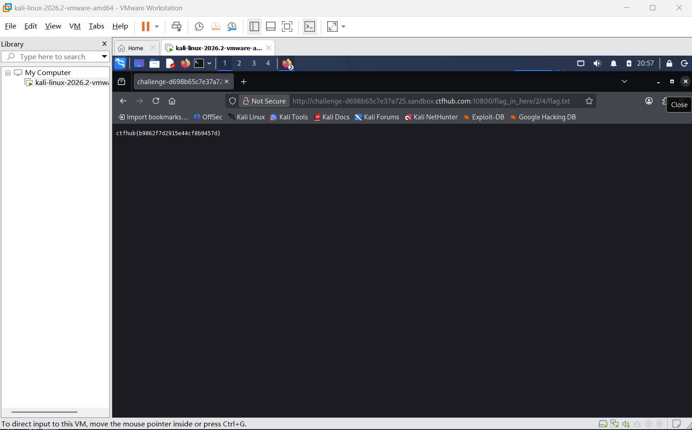

# WP：目录遍历

> **CTFHub 路径**：技能树 → Web → 信息泄露 → 目录遍历
> **任务**：按题目页面提示找到 flag。
> **提示**：注意页面给出的路径和 URL；目录列表本身就是一种信息泄露。只在题目环境内点击和访问，不要使用扫描器扫描其他地址。
> **截图要求**：能看到题目环境地址（或题目名称）、你访问的目录/路径，以及最终的 flag。

---

## 题目信息

| 项目 | 内容 |
| --- | --- |
| 环境地址 | http://challenge-d698b65c7e37a725.sandbox.ctfhub.com:10800 |
| Flag | ctfhub{b9862f7d2915e44cf8b9457d} |

## 解题过程

打开靶场首页，页面上只写了 /flag_in_here 这个目录，没有别的导航链接，说明服务器是把目录内容直接列出来的。我把这个目录拼到地址后面访问，返回的是 Apache 自动生成的目录索引，能看到下级子目录和文件清单。按索引一层层点进去，路径依次是 /flag_in_here/1/、/flag_in_here/2/，每个目录里又有若干用数字编号的子目录。最后在 /flag_in_here/2/4/ 里看到一个 flag.txt，大小 33 字节，正好是一个 flag 的长度。直接打开这个文件，内容就是 ctfhub{b9862f7d2915e44cf8b9457d}。

## 关键请求/响应

```http
GET /flag_in_here/2/4/flag.txt HTTP/1.1
Host: challenge-d698b65c7e37a725.sandbox.ctfhub.com:10800

HTTP/1.1 200 OK
Content-Type: text/plain

ctfhub{b9862f7d2915e44cf8b9457d}
```

本题不需要修改请求，只是逐级访问目录索引里给出的路径，关键是把 /flag_in_here/2/4/ 这个目录翻出来。

## 原理与复盘

这道题对应 HTTP 报文的响应体：服务器返回的不是一个正常页面，而是一份目录清单。原因是 Web 服务器开启了目录索引（autoindex），而该目录下又没有默认首页文件，于是把目录里的文件名、修改时间、大小直接写进响应体返回浏览器。目录列表本身不执行代码，但它把原本不该暴露的路径和文件清单交了出去，攻击者据此就能猜到 flag.txt、备份文件、源码文件的地址，属于典型的信息泄露。防御做法是关闭目录索引，并且不要把敏感文件放在 Web 目录下。

---

## 截图



> 可以在这份 WP 中另加过程截图；检查时只看指定图片，额外图片不检查。
