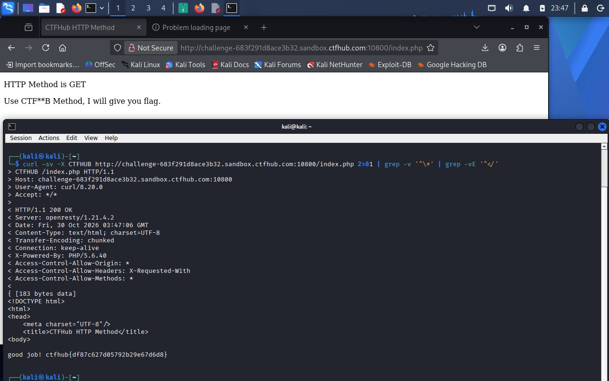

# WP：请求方式

> **CTFHub 路径**：技能树 → Web → Web 前置技能 → HTTP 协议 → 请求方式
> **任务**：按题目要求使用指定的 HTTP 方法访问目标，拿到 flag。
> **提示**：浏览器地址栏默认发送 GET 请求。用 Burp Repeater 修改请求行中的方法，或者用 `curl -X` 复现。
> **截图要求**：优先使用 Burp Repeater，截图中要能看到修改后的请求行（方法 + 路径）和响应中的 flag；如果 Burp 无法启动，可以用 `curl -X` 的方法修改截图代替，并在 WP 中说明原因。只有浏览器普通 GET 访问不算完成。

---

## 题目信息

| 项目 | 内容 |
| --- | --- |
| 环境地址 | http://challenge-683f291d8ace3b32.sandbox.ctfhub.com:10800/index.php |
| Flag | ctfhub{df87c627d05792b29e67d6d8} |

## 解题过程

用浏览器正常打开页面，正文提示 HTTP Method is GET，并写着 Use CTF**B Method, I will give you flag，意思是方法名被打了两个星号，需要自己补全。根据题目名和 CTFHub 的命名，把 CTF**B 补成 CTFHUB。浏览器地址栏只能发 GET，改不了方法，所以改用 curl 的 -X 参数直接指定请求方法为 CTFHUB，仍然访问 index.php。响应从 200 的提示页变成了 good job! 后面跟着 flag。这里用 curl 而不是 Burp Repeater，是因为本题只要改请求行里的方法，curl -v 会把请求行和响应头一起打印出来，证据链更直接，也不用额外配浏览器代理。

## 关键请求/响应

```http
CTFHUB /index.php HTTP/1.1
Host: challenge-683f291d8ace3b32.sandbox.ctfhub.com:10800
User-Agent: curl/8.20.0
Accept: */*

HTTP/1.1 200 OK
Content-Type: text/html; charset=UTF-8
X-Powered-By: PHP/5.6.40

good job! ctfhub{df87c627d05792b29e67d6d8}
```

普通 GET 访问 /index.php 只会返回 “HTTP Method is GET” 的提示页，把请求行的方法换成 CTFHUB 之后才返回 flag。

## 原理与复盘

HTTP 请求由请求行、请求头、请求体三部分组成，请求行是 GET /index.php HTTP/1.1 这样的格式，依次是方法、请求路径、协议版本，方法位于最前面。HTTP 协议本身允许自定义方法名，服务端可以只认某一个特定方法（本题是 CTFHUB），方法不对就返回普通提示。这提醒我：判断一个请求“是什么操作”看的是请求行里的方法，客户端可以随便改，服务端必须对每个入口都做校验。

---

## 截图



> 可以在这份 WP 中另加过程截图；检查时只看指定图片，额外图片不检查。
