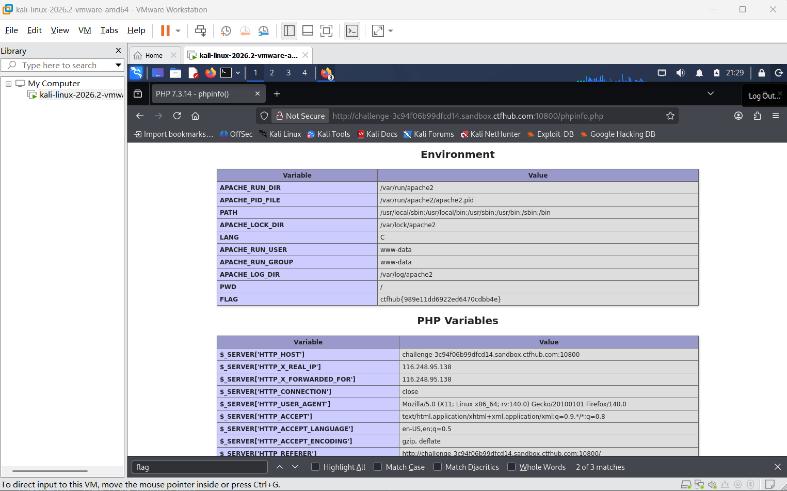

# WP：PHPINFO

> **CTFHub 路径**：技能树 → Web → 信息泄露 → PHPINFO
> **任务**：在 phpinfo 页面中找到 flag，并观察它泄露了哪些信息。
> **提示**：phpinfo 会输出大量 PHP 和服务器配置。用浏览器的查找功能搜索关键字，同时留意页面暴露的路径、版本、环境变量等信息。
> **截图要求**：能看到 phpinfo 页面、你搜索/定位到的 flag，以及至少一处敏感信息。

---

## 题目信息

| 项目 | 内容 |
| --- | --- |
| 环境地址 | http://challenge-3c9406b99dfcd14.sandbox.ctfhub.com:10800/phpinfo.php |
| Flag | ctfhub{989e11dd6922ed6470cdbb4e} |

## 解题过程

打开题目地址后，直接就是一个完整的 phpinfo 页面，从上到下是 PHP 版本、编译参数、模块、Environment、PHP Variables 等大段配置。页面太长，我没有往下翻，而是用浏览器自带的查找功能（Ctrl + F）搜关键字 flag。查找结果定位到 Environment 表格里单独的一行 FLAG，值就是 ctfhub{989e11dd6922ed6470cdbb4e}。同一张表里还泄露了 APACHE_RUN_DIR、APACHE_LOG_DIR、PWD 这些服务器路径。下面的 PHP Variables 里还能看到 _SERVER[“HTTP_HOST”]、_SERVER[“HTTP_USER_AGENT”] 以及服务器内网地址，说明客户端请求头也会被完整回显。

## 关键请求/响应

```http
GET /phpinfo.php HTTP/1.1
Host: challenge-3c9406b99dfcd14.sandbox.ctfhub.com:10800

HTTP/1.1 200 OK
Content-Type: text/html; charset=UTF-8

Environment
FLAG    ctfhub{989e11dd6922ed6470cdbb4e}
PWD     /
APACHE_RUN_USER   www-data
```

本题不需要修改请求，关键是在 phpinfo 输出的环境变量表里定位到 FLAG 这一行。

## 原理与复盘

phpinfo 是 PHP 自带的调试函数，会一次性把 PHP 版本、编译参数、加载的模块、服务器软件的路径与配置文件位置、环境变量、请求头等全部打印成网页，信息量极大。对攻击者来说，这些信息可以用来匹配已知漏洞的版本号、判断可用的危险函数、找到配置文件与日志路径，甚至直接读到误写进环境变量的密钥，也就是本题的 flag。因此生产环境必须删掉 phpinfo 页面，或者限制只有内网、指定 IP 可以访问。

---

## 截图



> 可以在这份 WP 中另加过程截图；检查时只看指定图片，额外图片不检查。
