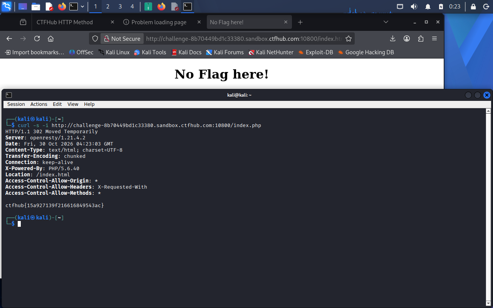

# WP：302 跳转

> **CTFHub 路径**：技能树 → Web → Web 前置技能 → HTTP 协议 → 302 跳转
> **任务**：观察 302 重定向，按题目提示找到 flag。
> **提示**：浏览器通常会自动跟随 302，所以你可能只看到最终页面。打开 DevTools 的 Network 面板（勾选 Preserve log）或 Burp，查看原始响应中的 `302` 状态码和 `Location` 响应头。
> **截图要求**：能看到 302 状态码和/或 `Location` 响应头，以及最终的 flag。只截最终页面、没有 302 证据的截图不合格。

---

## 题目信息

| 项目 | 内容 |
| --- | --- |
| 环境地址 | http://challenge-8b70449bd1c33380.sandbox.ctfhub.com:10800/index.php |
| Flag | ctfhub{15a927139f216616849543ac} |

## 解题过程

用浏览器打开 index.php，页面上只有一句 No Flag here! 和一个 Give me Flag 的链接，点进去地址栏变成了 /index.html，页面还是那句 No Flag here!，从头到尾看不到 flag。这个现象说明中间发生了一次我肉眼看不见的跳转：服务器先返回了一个 302，浏览器把 302 吞掉、自动跟着 Location 又发了一次请求，所以我只看到落地页。

换成 curl 抓原始响应，并且故意不加 `-L`，让 curl 不跟随跳转、只发这一次请求。结果响应头里清楚看到状态行 HTTP/1.1 302 Moved Temporarily 和 Location: /index.html，而响应头之后空一行，响应体里直接就是 flag。也就是说这一题藏起来的不是跳转目标，而是 3xx 响应的响应体：浏览器一旦跟随跳转，就会把这段内容丢掉，只有拦住那一次 302 才看得到。

## 关键请求/响应

```http
GET /index.php HTTP/1.1
Host: challenge-8b70449bd1c33380.sandbox.ctfhub.com:10800

HTTP/1.1 302 Moved Temporarily
Server: openresty/1.21.4.2
Date: Fri, 30 Oct 2026 04:23:03 GMT
Content-Type: text/html; charset=UTF-8
Transfer-Encoding: chunked
Connection: keep-alive
X-Powered-By: PHP/5.6.40
Location: /index.html

ctfhub{15a927139f216616849543ac}
```

`curl -i` 不加 `-L` 才能看到这条 302 和它的响应体；浏览器和 `curl -L` 都会自动跟随到 /index.html，把这段内容丢掉。

## 原理与复盘

200 是这次请求成功，浏览器直接把响应体渲染成页面；302 是临时重定向，真正的去向写在 Location 响应头里，浏览器读完会自动再发一次请求，所以地址栏里只看到最终地址。做题时的教训是：不能把“浏览器显示了什么”当成服务器返回了什么，3xx 响应本身也可以带响应体，而浏览器在跟随跳转时会把它丢掉。想看清中间过程，就得用 `curl -i` 不跟随，或者在 DevTools 的 Network 面板勾上 Preserve log 再看那条 302。

---

## 截图



> 可以在这份 WP 中另加过程截图；检查时只看指定图片，额外图片不检查。
