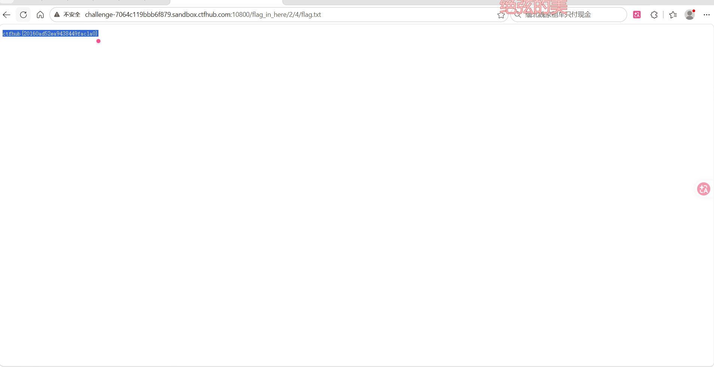

# WP：目录遍历

> **CTFHub 路径**：技能树 → Web → 信息泄露 → 目录遍历
> **任务**：按题目页面提示找到 flag。
> **提示**：注意页面给出的路径和 URL；目录列表本身就是一种信息泄露。只在题目环境内点击和访问，不要使用扫描器扫描其他地址。
> **截图要求**：能看到题目环境地址（或题目名称）、你访问的目录/路径，以及最终的 flag。

---

## 题目信息

| 项目 | 内容 |
| --- | --- |
| 环境地址 | http://challenge-7064c119bb6f879.sandbox.ctfhub.com:10800 |
| Flag | ctfhub{20160ad52ea9438449fac1a0} |

## 解题过程

打开题目页面后，提示 flag 藏在某个目录里，需要自己顺着目录去找。我先访问 /flag_in_here/，服务器直接把目录列表返回了出来；列表里按 1、2、3、4 这类数字分层给出子目录，我逐层点进去缩小范围。最后在 /flag_in_here/2/4/flag.txt 这个路径下看到了完整的 flag。

## 关键请求/响应

```http
GET /flag_in_here/2/4/flag.txt HTTP/1.1
Host: challenge-7064c119bb6f879.sandbox.ctfhub.com:10800

本题不需要修改请求，直接用浏览器访问上面的 URL，响应体就是 flag。
```

## 原理与复盘

这道题对应 HTTP 请求报文的请求行，具体是其中的 URL 路径部分。服务器没有关闭目录列表，访问目录时就把文件清单返回给你，攻击者可以像翻文件夹一样逐层浏览，于是看到本不该公开的文件，属于典型的信息泄露。

---

## 截图



> 可以在这份 WP 中另加过程截图；检查时只看指定图片，额外图片不检查。

