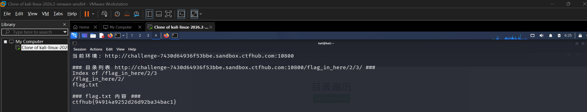

# WP：目录遍历

> **CTFHub 路径**：技能树 → Web → 信息泄露 → 目录遍历
> **任务**：按题目页面提示找到 flag。
> **提示**：注意页面给出的路径和 URL；目录列表本身就是一种信息泄露。只在题目环境内点击和访问，不要使用扫描器扫描其他地址。
> **截图要求**：能看到题目环境地址（或题目名称）、你访问的目录/路径，以及最终的 flag。

---

## 题目信息

| 项目 | 内容 |
| --- | --- |
| 环境地址 | http://challenge-7430d64936f53bbe.sandbox.ctfhub.com:10800/ |
| Flag | ctfhub{94914a9252d26d92ba34bac1} |

## 解题过程

开启题目后，我在 Kali 的浏览器里打开靶场地址，看到一个很简陋的 Apache 目录列表页：标题是 `Index of /flag_in_here`，页面里没有任何正文，只有 `1/`、`2/`、`3/`、`4/` 四个以数字命名的子目录链接，页脚还老老实实写着 `Apache/2.4.38 (Debian) Server at challenge-7430d64936f53bbe.sandbox.ctfhub.com Port 10800`。也就是说服务器直接把磁盘上的目录结构列给人看了。

我点了几个后发现规律：每进一层，页面形式完全没变，还是四个数字子目录——这是一棵四叉树，第一层 4 个、第二层每个又是 4 个，末端一共 16 个目录。在树里靠手点容易迷路，所以我改用终端批量走一遍：对每个 `/<a>/<b>/` 各请求一次，只看返回的列表里有没有"不是目录"的文件名。

结果只有 `/flag_in_here/2/3/` 这一层多出一个 `flag.txt`，其余全是清一色的数字目录。剩下的就好办了：直接打开这个 txt，服务器把文件内容原样吐出来，里面就是 flag，回题目页面提交后平台提示正确。

一个体会是：这道题真正暴露的信息不是 flag 本身，而是"目录列表对外可读"这件事——URL 路径和磁盘路径一一对应，没有任何访问控制，连"文件藏在哪一层"都能直接从列表页读出来，完全不需要猜。

## 关键请求/响应

```http
GET /flag_in_here/ HTTP/1.1
Host: challenge-7430d64936f53bbe.sandbox.ctfhub.com:10800
User-Agent: Mozilla/5.0 (X11; Linux x86_64; rv:115.0) Gecko/20100101 Firefox/115.0
Accept: text/html,application/xhtml+xml

HTTP/1.1 200 OK
Server: Apache/2.4.38 (Debian)
Content-Type: text/html; charset=UTF-8

<title>Index of /flag_in_here</title>
<a href="1/">1/</a>  <a href="2/">2/</a>  <a href="3/">3/</a>  <a href="4/">4/</a>

--- 一路走到底：只有 2/3 这一层出现了普通文件 ---

GET /flag_in_here/2/3/ HTTP/1.1
Host: challenge-7430d64936f53bbe.sandbox.ctfhub.com:10800
User-Agent: curl/8.20.0

HTTP/1.1 200 OK
Server: Apache/2.4.38 (Debian)
Content-Type: text/html; charset=UTF-8

<title>Index of /flag_in_here/2/3</title>
<a href="/flag_in_here/2/">Parent Directory</a>
<a href="flag.txt">flag.txt</a>

--- 打开 flag.txt ---

GET /flag_in_here/2/3/flag.txt HTTP/1.1
Host: challenge-7430d64936f53bbe.sandbox.ctfhub.com:10800

HTTP/1.1 200 OK
Content-Type: text/plain

ctfhub{94914a9252d26d92ba34bac1}
```

## 原理与复盘

这题落在 HTTP 报文最前面的**请求行**里，具体是 URL 的 path：服务器把 path 直接映射成磁盘路径去列目录，既没做访问控制，也没关掉目录浏览，于是用户请求什么路径，就能看到磁盘上对应位置的完整内容。

关键不在"遍历"这个动作有多复杂，而在于**目录列表本身就把答案暴露了**。正常情况下攻击者要猜文件名（`flag.txt` 这种名字根本猜不到藏在 16 个目录中的哪一个），但 autoindex 一开，每个层级有哪些文件都直接列在页面上，等于把地图直接给了人。这就是它被归到「信息泄露」而不是「路径穿越」的原因。

防御上要做三件事：关掉目录浏览（Apache 的 `Options -Indexes`）、把 web 根目录之外的内容物理隔离、以及让敏感文件不落在可访问目录里。靠"路径猜不到"当安全边界是无效的——只要有人遍历一次目录树，所有文件名都暴露了。

---

## 截图



> 可以在这份 WP 中另加过程截图；检查时只看指定图片，额外图片不检查。
